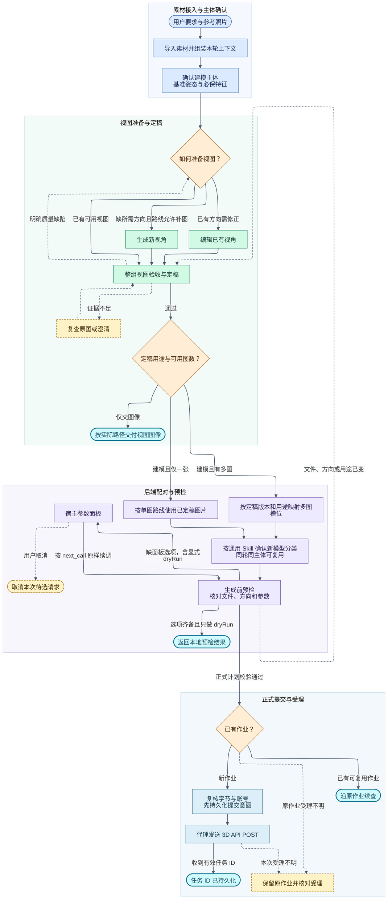
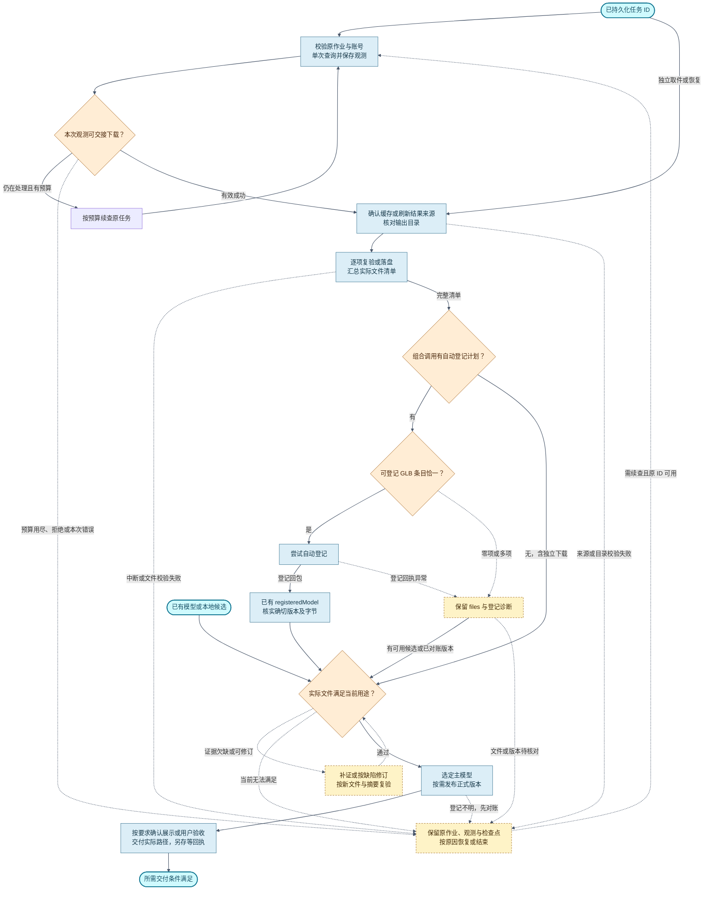

<!-- 文件信息：Hi3D 1.2.11 的逆向分析导航。
作用：保留原实现、证据范围及历史迁移判断的入口。
边界：正文中的 Vet3D 交接建议属于历史分析，不定义重新实施的产品架构。 -->
# Hi3D Agent · 多视图建模

本目录记录 Hi3D 的参考行为与当时的迁移判断。其中“Vet3D 实现交接”“迁移”等建议不自动成为当前产品需求、架构或实施前置；当前方向见[项目入口](../../README.md)。原始证据、历史测试及正文保留其原有含义，不因新实现路线调整而改判。

以 Hi3D Agent 1.2.11（Windows x64）为核查基准。前半段从用户提供照片和建模要求开始，追踪到桌面发起 3D 生成请求并持久化任务 ID。主线是普通多视图图生 3D，补图、修图和领域验收按条件进入。后半段从已受理的任务开始，覆盖原作业续查、确认下载来源、逐项落盘、候选验收、条件修订与交付。UV、纹理和 LOD 各有独立交接。

[前半段总流程](#前半段总流程) · [节点导航](#节点导航) · [后半段总流程](#后半段总流程) · [后半段节点](#后半段节点) · [Vet3D 实现交接](#vet3d-实现交接) · [基础设施](#基础设施) · [条件分支与证据](#条件分支与证据)

## 前半段总流程

根据已核实实现与 Skill 规则重建。实线表示主流程及正常分流，虚线表示返工、澄清或异常出口。

## 节点导航

| 阶段 | 交给下一步的信息 | 技术说明 |
| --- | --- | --- |
| 素材接入 · 工作区基础设施 | 实际工作区、原件路径、会话可见图像和用户指令。候选建模图另核对提交格式及实际版本。 | [导入参考素材](infrastructure/workspace/import-reference-materials.md) · [组装本轮上下文](infrastructure/workspace/llm-context.md#组装本轮正文和附件) |
| 确认建模主体 | 目标个体、基准姿态、参考图角色和必保特征。普通新模型按通用 Skill 在生成前记录主角分类。 | [确认建模主体](atomic-nodes/confirm-modeling-subject.md) |
| 生成新视角 · 条件分支 | 缺失方向的候选文件、版本及来源 | [生成新视角](atomic-nodes/generate-new-view.md) |
| 编辑已有视角 · 条件分支 | 修订后的候选版本、修改范围和保留项 | [编辑已有视角](atomic-nodes/edit-existing-view.md) |
| 整组验收与定稿 | 通过验收的文件版本、各图用途、方向及审查依据 | [整组视图验收与定稿](atomic-nodes/review-and-finalize-view-set.md) |
| 多视图按位置配对 | 与后端槽位逐项对应的文件及顺序 | [多视图按位置配对](atomic-nodes/pair-multiview-inputs.md#从方向标签追踪到上传字节) |
| 生成前预检 | 本次展开请求、参数状态和可追溯的作业路径。按实际计划核对高级参数及兼容字段。 | [生成前预检](atomic-nodes/preflight-generation.md) |
| API 交接 | 实际 POST、持久化的任务 ID，或待核对的原作业 | [提交与恢复](atomic-nodes/preflight-generation.md#完成条件与恢复) · [Hi3D API 工具](tools/hi3d-api.md#作业持久化与恢复) |

## 后半段总流程

组合调用可在一次工具执行中等待、下载并按条件自动登记。各阶段的完成条件分别核对。已有工作区模型或本地修订候选可从确切文件直接进入适用性检查。 [组合回包与自动登记](tools/hi3d-api.md#已下载-3d-产物与登记) · [交付验收](infrastructure/workspace/preview-and-deliver-files.md#验收)

## 后半段节点

取得任务 ID 后沿原作业查询和取件，按用途核对实际候选。候选满足当前用途时进入主模型交接。需要修改时先固定源版本与改动范围，按下表选择对应分支，再验收导出。绑定、动画、游戏接入与打印交付按任务用途启用。 [绑定与动作验收](upstream/1.2.11/prebuilt-skills/rig-retarget/references/validation.md) · [游戏接入](upstream/1.2.11/prebuilt-skills/hi3d-game-demo/references/assets.md)

| 阶段 | 交给下一步的信息 | 技术说明 |
| --- | --- | --- |
| 定位原作业并校验续查资格 | 经账号、环境与代理校验的原作业和任务 ID。受理不明且缺 ID 时保留原记录核对。 | [定位原作业并校验续查资格](atomic-nodes/locate-job-and-qualify-resume.md) |
| 执行单次查询并持久化观测 | 同一任务 ID 的有效观测、本地查询拒绝或陈旧诊断。 | [执行单次查询并持久化观测](atomic-nodes/observe-job-once.md) |
| 调度等待并决定交接 | 续查预算和原作业状态。取得新鲜成功后，交接原作业与适用的输出目录。 | [调度等待并决定交接](atomic-nodes/schedule-wait-and-handoff.md) |
| 确认下载来源与恢复方式 | 待复验的本地清单，或原任务的新鲜候选 URL 及绑定目录。遇阻时保留原作业和恢复依据。 | [确认下载来源与恢复方式](atomic-nodes/confirm-download-source-and-recovery.md) |
| 逐项下载与产物清单落盘 | 已完整复验或落盘的文件路径、大小与摘要。部分成功保留逐项断点，本次候选集合处理完才发布聚合清单。 | [逐项下载与产物清单落盘](atomic-nodes/download-and-persist-artifact-manifest.md) |
| 核对候选对当前任务的适用性 | 确切候选、适用性证据及未覆盖项。可修订的问题连同保留项交相应分支。 | [核对候选对当前任务的适用性](atomic-nodes/check-model-candidate-suitability.md) |
| 选定主模型并确认交接 | 固定确切候选或对应的正式版本，按用途分别确认登记、Studio 就绪、链接交付及实际另存。 | [选定主模型并确认交接](atomic-nodes/select-primary-model-and-confirm-handoff.md) · [模型版本登记](infrastructure/workspace/import-or-register-model-version.md) · [文件交付](infrastructure/workspace/preview-and-deliver-files.md) |

### 模型修订与派生产物

| 条件分支 | 交给下一步的信息 | 技术说明 |
| --- | --- | --- |
| 局部结构修订 | 源版本及局部改动范围，经过结构、近景与保留项复验的候选。 | [局部结构修订](atomic-nodes/revise-local-structure.md) |
| 模型与部件变换 | 源版本、目标部件、坐标及尺寸依据，验收通过的 GLB 或打印路线实际生成的 3MF。 | [模型与部件变换](atomic-nodes/transform-model-and-parts.md) |
| 材质与纹理修订 | 源版本、改动范围、参考及保留项，通过本地修订或云端仅贴图后的验收结果。 | [材质与纹理修订](atomic-nodes/revise-materials-and-textures.md) |
| 网格缺陷修复与水密化 | 绑定源版本的诊断，或通过拓扑与保留项复验的 GLB 候选。 | [网格缺陷修复与水密化](atomic-nodes/repair-mesh-and-make-watertight.md) |
| 重拓扑与边流验收 | 通过面型、边链、保形与属性检查的可编辑网格，按任务交接 GLB 和报告。 | [重拓扑与边流验收](atomic-nodes/retopology-and-edge-flow-review.md) |
| 建立与验收目标 UV | 确切目标网格、已验收的 UV 层、需上图范围及布局证据。 | [建立与验收目标 UV](atomic-nodes/establish-and-review-target-uv.md) |
| 迁移已有贴图与烘焙细节 | 与确切目标 UV 对应的贴图、通道绑定、改动范围及验收证据。 | [迁移已有贴图与烘焙细节](atomic-nodes/migrate-textures-and-bake-details.md) |
| 依据参考图为已有网格生成纹理 | 验收通过的带纹理候选、源网格、实际条件图和原任务标识。 | [依据参考图为已有网格生成纹理](atomic-nodes/generate-texture-for-existing-mesh.md) |
| 确定 LOD 源网格与分档预算 | 有复用依据的逐档文件，或与源版本、预算及必保要求绑定且已完成预检的新派生计划。 | [确定 LOD 源网格与分档预算](atomic-nodes/plan-lod-source-and-budgets.md) |
| 派生并核对档位文件 | 原作业回执、目标档位与实际文件及摘要的对应、下载或缺档记录。 | [派生并核对档位文件](atomic-nodes/derive-and-check-lod-files.md) |
| 逐档验收与整组定稿 | 必交档位的验收结论、最终文件清单及按需取得的工作区版本。 | [逐档验收与整组定稿](atomic-nodes/review-and-finalize-lod-set.md) |

### 骨架绑定与动作适配

| 阶段 | 交给下一步的信息 | 技术说明 |
| --- | --- | --- |
| 确认用途、姿态和绑定路线 | 固定源资产、交付范围与静止姿态依据，交接新绑定、复用已有绑定或局部诊断的路线及证据。 | [确认用途、姿态和绑定路线](atomic-nodes/confirm-rigging-purpose-pose-and-route.md) |
| 划定身体与附属部件的绑定域 | 在休止空间确认连续身体、软部件、刚性部件与道具的边界，按云端或本地路线交准备输入。 | [划定身体与附属部件的绑定域](atomic-nodes/define-body-and-accessory-binding-domains.md) |
| 导出并验收云端绑定身体 GLB | 提交件实际回读与离线预检均通过，交确切文件、摘要、原高模及回迁名单。 | [导出并验收云端绑定身体 GLB](atomic-nodes/export-and-review-cloud-rig-body-glb.md) |
| 提交并恢复自动绑定 | 保留原作业与关联号，按原成功账本补下载，交经过文件身份和摘要核对的绑定候选。 | [提交并恢复自动绑定](atomic-nodes/submit-and-recover-auto-rig.md) |
| 构建并验收本地连续皮肤网格 | 固定回读通过的身体工程、实际休止空间和最终拓扑，交本地骨架标定。 | [构建并验收本地连续皮肤网格](atomic-nodes/build-and-review-local-continuous-skin-mesh.md) |
| 标定本地骨架与蒙皮范围 | 新建路线交对应最终网格的标定配置与初始权重输入。已有骨架轴向调整交重开后的工程、变更报告及姿势验收状态。 | [标定本地骨架与蒙皮范围](atomic-nodes/calibrate-local-skeleton-and-skinning-scope.md) |
| 求解本地权重并建立绑定 | 交可重开的绑定工程、骨架与部件清单、求解回执和本轮姿势验收范围，继续动作适配或按用途导出。 | [求解本地权重并建立绑定](atomic-nodes/solve-local-skin-weights-and-bind.md) |
| 核对骨架与蒙皮候选 | 核对云端、本地或已有绑定的实际文件、骨架与权重，交可回迁或可复用的候选及检查覆盖范围。 | [核对骨架与蒙皮候选](atomic-nodes/review-rig-and-skinning-candidate.md) |
| 向认可的高模或目标部件回迁权重 · 条件 | 交重开核对的绑定工程、实际骨架与软目标名单、属性保护及姿势／动作检查范围；按用途继续适配、诊断或交付。 | [向认可的高模或目标部件回迁权重](atomic-nodes/transfer-skin-weights-to-approved-mesh.md) |
| 固定并求值源动作 | 固定来源、源骨架及动作栈，交通过时间、空间和实际运动核验的缓存、摘要与检查范围，继续建立目标映射。 | [固定并求值源动作](atomic-nodes/fix-and-evaluate-source-motion.md) |
| 校准骨轴与动作映射 | 固定目标工程、实际 rest 摘要与源缓存身份，交映射及验收覆盖，进入重定向与烘焙或复用已有动作候选。 | [校准骨轴与动作映射](atomic-nodes/calibrate-bone-axes-and-map-motion.md) |
| 重定向并烘焙动作 | 执行或复用同身份、同范围的动作，交可重开的 Action 工程、时间及保护证据，继续完整动作与形变验收。 | [重定向并烘焙动作](atomic-nodes/retarget-and-bake-motion.md) |
| 重开并验收绑定与动作 | 从实际保存候选核对绑定、保留项和要求动作，分别交结构、数值、实际审看及条件回读结论。 | [重开并验收绑定与动作](atomic-nodes/reopen-and-review-rig-and-motion.md) |
| 定位形变并局部修权重 · 条件 | 交与实际输入及权重版本对应的诊断、局部规则、新候选和同范围复验；按归因回校准、继续动作验收或交付。 | [定位形变并局部修权重](atomic-nodes/locate-deformation-and-repair-local-weights.md) |
| 导出、回读与交付 | 按用途固定实际输出、回读范围及登记版本摘要，分别确认链接备妥、Studio 就绪和用户实际另存。 | [导出、回读与交付](atomic-nodes/export-readback-and-deliver.md) |

## Vet3D 实现交接

业务层保存文件身份、用途、必保项和验收范围。执行适配器保存原任务、关联号及恢复依据，并为实际候选提供可核对的本地文件引用。LLM、生图与 3D 模型仍待选型。

| 处理路线 | 可以交给下游的条件 | 证据范围 |
| --- | --- | --- |
| 原作业 → 已落盘候选 | 原任务身份、输出目录和完整文件清单一致，按实际路径与摘要交给候选验收。每项断点和聚合结果分别保存。 | 已核查安装包、隔离恢复及留存组合调用。实际签名过期、断网及宿主重启恢复待实测。 [下载证据](atomic-nodes/download-and-persist-artifact-manifest.md#核查依据与缺口) |
| 目标 UV → 贴图迁移、融合或烘焙 | 下游持有同一目标网格及 UV 的验收记录，并能根据逐通道绑定、改动范围和实际贴图复验导出。 | 随包契约与隔离脚本已核查。生产 UV 展开和真实四足模型的接缝、材质及动作表现待实测。 [UV 证据](atomic-nodes/establish-and-review-target-uv.md#安装包证据样例与缺口) · [烘焙证据](atomic-nodes/migrate-textures-and-bake-details.md#安装包证据样例与缺口) |
| 参考图 → 既有网格纹理 | 候选可追溯到确切目标网格、实际条件图和原作业。验收通过后交登记，需换到其他目标网格时再按实际目标 UV 迁移。 | 已核查离线组包及原任务恢复分支。线上条件图利用、几何和 UV 保留、四足纹理质量待实测。 [纹理生成证据](atomic-nodes/generate-texture-for-existing-mesh.md#安装包证据样例与缺口) |
| 规划 → LOD 派生或复用 → 整组定稿 | 分开保存作业结果、档位文件齐全结论、逐档质量结论与正式登记回执。复用已有候选可直接进入逐档验收。 | 已核查安装包、离线预检、提交与恢复的隔离分支及合成验收。真实云端输出及恢复、四足动画和档位整组登记待实测。 [档位文件证据](atomic-nodes/derive-and-check-lod-files.md#安装包证据样例与缺口) · [整组验收证据](atomic-nodes/review-and-finalize-lod-set.md#安装包证据样例与缺口) |
| 绑定／动作工程 → 最终文件与交付 | 固定对象、动作、单位与输出摘要，完成实际回读；登记返回版本再对账，链接与实际另存分开记录。 | 已核查七骨三帧导出／独立回读及登记、宿主静态链。Studio 重新导出不等价于原文件复制；真实四足、材质、完整动作、引擎与真实另存待验。 [交付证据与边界](atomic-nodes/export-readback-and-deliver.md#安装包证据样例与缺口) |

## 基础设施

- **工作区与执行上下文。** 可从生命周期入口追踪工作区创建、会话绑定、LLM 可见状态、版本登记和实际交付。 [创建工作区](infrastructure/workspace/create-workspace.md) · [会话绑定与恢复](infrastructure/workspace/bind-and-restore-workspace-session.md) · [LLM 上下文](infrastructure/workspace/llm-context.md) · [工作区交付](infrastructure/workspace/preview-and-deliver-files.md)
- **随包运行依赖。** 以材质节点、纹理烘焙和模板贴图为例追踪本地执行环境。 [静态资源与脚本工具](infrastructure/bundled-assets-and-script-tools.md) · [P0 基础资源](resources/README.md) · [P1 建模与验收资源](resources/p1/README.md)

## 条件分支与证据

- **普通 Hi3D 路线。** 多视图使用用户实际提供且标明方向的照片，包含正面，其他方向可缺省。只有一张时进入单图路线。装配与人像的专项规则仅在选用对应 Skill 后生效。仅要求视图图片时，定稿后直接交付。 [通用 Skill](upstream/1.2.11/prebuilt-skills/hi3d/SKILL.md#默认行为) · [领域验收](atomic-nodes/review-and-finalize-view-set.md#skill-绑定)
- **换图与能力不匹配。** 定稿固定实际文件版本和用途。文件、方向或用途改变后回到验收，取得新定稿再配对。Vet3D 要求五图都参与重建时，Hi3D 的四槽入口应判为能力不匹配。只有任务允许时，顶图可仅供验收。 [五视图契约](atomic-nodes/review-and-finalize-view-set.md#面向五视图的契约)
- **预检与作业身份。** 正式 `generate_3d` 内含本地预检。参数面板答复合并至 `settings`，按 `next_call` 保留原图片、方向和作业路径续调，取消则结束本次待选请求。同一个 `jobPath` 对应的计划指纹冲突时，保留原记录并停止提交。收到有效 `data.jobId` 后先写入原作业。受理不明时按原记录及已知任务 ID 核对，有可靠证据找回原 ID 后可续查。 [预检分支](atomic-nodes/preflight-generation.md#执行) · [作业恢复](atomic-nodes/preflight-generation.md#完成条件与恢复)
- **已核实与待实测。** 本机样本记录了三份照片原件、面板续调、已落盘的生成作业，以及服务回传的非空槽位 `[0,1,3]`。逐图视觉判断的具体依据、真实补图质量及重建效果仍须另行核查。 [本机运行与离线证据](atomic-nodes/pair-multiview-inputs.md#vet3d-迁移与核查范围) · [Skill 与安装包归档](upstream/1.2.11/README.md) · [独立 Tool 索引](tools/README.md)
