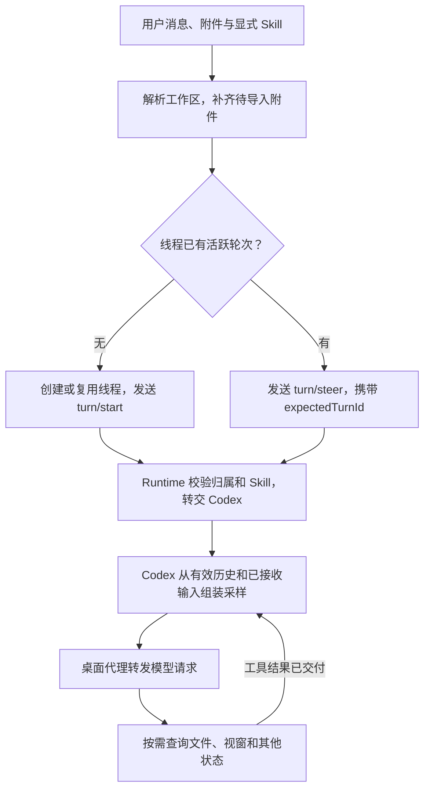

# 构建当前轮的工作区上下文

核查对象为本机 Hi3D Agent 1.2.11（Windows x64）和随包 Codex 0.166.0。本节点位于工作区基础设施层，覆盖从桌面准备轮次输入到 Codex 形成模型请求的链路，以及恢复时如何重建模型可见内容。

## 流程总览

**根据已核查实现重建的流程图。** 显示桌面提交、线程绑定、首次采样和工具续采样的交接。



| 本轮需要的信息 | 来源与读取时机 |
| --- | --- |
| 工作区归属与可用目录 | 已有线程由宿主用注册表解析 `threadId → assetId → cwd`。无工作区的草稿先领取目录，再用该目录创建线程。恢复线程时按登记记录还原 `cwd`。 |
| 用户指令、附件与已选 Skill | 首次提交或补充输入时，从本次发送内容组装。原件引用、预览像素、Skill 目录和实际进入采样的 Skill 正文各有独立来源。 |
| 已有素材与模型版本 | 优先使用本次消息或有效工具结果中的确切引用。还需查找时，由[素材与模型版本查询](query-assets-and-model-versions.md)解析。 |
| 用户当前看到的模型 | 任务依赖此信息时，按[读取当前视窗状态](read-studio-state.md)取得实际加载版本。普通 `turn/start` 的消息、附件及 Skill 项中没有附带实时视窗状态。 |

## 业务定义

| 项目 | 节点契约 |
| --- | --- |
| 触发条件 | 用户提交首条消息、在既有线程开启新一轮、向活跃轮补充输入，或在恢复、压缩后继续执行。恢复发送时沿用原发送草稿及其工作区归属。 |
| 上游与输入 | 接收工作区、已有线程和活动轮次状态（如适用）、用户正文、附件、显式 Skill 引用及模型设置。恢复时还需有效历史检查点和后续记录。 |
| 输出 | 宿主交付绑定到 `threadId` 的有序输入、工作区范围和线程能力配置。Codex 为每次采样组装有效历史、本轮输入、模型可见指令和工具。新轮取得新的 `turnId`，补充输入沿用目标轮次。向后续步骤交接时，按任务核对当前采样已取得的 Skill 正文、阶段依赖及媒体。 |
| 完成条件 | 宿主交接以轮次受理和输入可追溯为准。依赖特定媒体、Skill 正文或阶段材料的操作，在相应内容已进入该次采样时才就绪。恢复时复核检查点、当前 Skill 修订和资产版本。 |
| 下游 | Agent 获得本轮消息和可访问的资产引用。[确认建模主体](../../atomic-nodes/confirm-modeling-subject.md)据此判断主体和姿态。生成路线另行确定主体基准、主图、参考图、目标视角与必保特征，再交给[生成前预检](../../atomic-nodes/preflight-generation.md)。涉及「当前模型」时，读取 [Studio 实际加载的版本](read-studio-state.md)。 |

`assetId` 是 Hi3D 的工作区标识。编辑框中的附件 UUID、会话 `threadId`、执行 `turnId` 和生成服务的任务 ID 分别用于不同的关联。本节点产出的原件与预览引用均可供 Agent 使用，实际生成输入由下游显式选定。

## Skill 绑定

附件落盘、线程归属检查、消息组装和有效 Skill 校验属于通用宿主流程。它们随会话运行。建模或评审规则在选用相应 Skill 后适用。下表版本均为仓库内归档的 1.2.11 快照。 [归档版本说明](../../upstream/1.2.11/README.md)

| 归档 Skill | 作用与选用条件 | SHA-256 |
| --- | --- | --- |
| [hi3d/SKILL.md](../../upstream/1.2.11/prebuilt-skills/hi3d/SKILL.md) | **通用建模入口。** 用户要求普通图片生成、编辑或图生 3D 时使用。它指导 Agent 怎样查看、选择和使用已经交接的素材，以及怎样生成、预检和恢复。 | `4c268ae14ece561234682d564cdfa6264c1f121a9ea118137c0388a9240c217d` |
| [image-to-assembly/SKILL.md](../../upstream/1.2.11/prebuilt-skills/image-to-assembly/SKILL.md) | **静态装配领域 Skill。** 选用逐部件重建、配准或装配路线时，使用该流程的来源记录、方向审查、粗模关卡和已审查视图清单。 | `cf4ec08dec0decfd69560a940cc26ea18fecf559ea87852c269fd2682555705f` |
| [head-reference/SKILL.md](../../upstream/1.2.11/prebuilt-skills/head-reference/SKILL.md) | **头部参考图领域 Skill。** 选用人像头部参考图流程时，使用其姿态基准、图像版本及评审契约。 | `7e7fa5b0cd74928feac546a64edb0d71c77d66f6e5756bfef8c528523af95795` |

### 有效目录与选用

`effectiveSkills.forWorkspace` 校验工作区归属，汇总官方入口和已启用且安装内容通过完整性校验的用户级导入 Skill。同名时官方项优先。Runtime 读取官方 `SKILL.md` 的 frontmatter 并计算修订摘要，`oR` 只向模型交付名称、描述、来源、作用域与入口路径。`thread/start`、`thread/resume`、`thread/fork` 配置 Codex 的启用路径，并将 `<hi3d_effective_skills>` 加入开发者指令。`skills.include_instructions = false` 关闭 Codex 原生目录提示。普通新轮分别检查线程配置和独立目录注入的代际，必要时恢复配置并用 `thread/inject_items` 注入当前目录。 [Runtime `Hv`、`prepareAppServerParams`、`prepareTurnSkills`、`oR`](<D:/install/Hi3DAgent.__hi3d-transaction/resources/runtime/dist/runtime.mjs>)

桌面编辑框的可选名单使用 renderer 的 `Ke`，取 63 个官方候选名称与有效目录的交集，再加入导入项。`image-to-assembly` 在这份官方名单中，`hi3d` 与 `head-reference` 仍可出现在模型目录中。两份本机 rollout 第 4、9 行均记录 102 项官方入口和一个路径根别名，活跃样本第 195、243 行再次记录相同规模的目录。 [Electron renderer `Mpe`、`S1`、`Ke`](<D:/install/Hi3DAgent.__hi3d-transaction/resources/app.asar>)

| 选用路线 | 选择与校验 | 正文进入采样的时机 |
| --- | --- | --- |
| 新轮收到类型化 Skill | 选择器写入 `$name`。编辑框识别已知名称的手写 `$name` 后也可生成结构化选择。`QI` 发送 `{type: "skill", name, path, instanceId, revisionId}`，`cS` 将它排在正文之前。Runtime 用四项标识精确匹配有效项，拒绝失效选择，再移除实例和修订 ID。 | Codex 优先按已启用的规范路径或发现路径解析，读取 `SKILL.md`，在用户输入之后记录含名称、路径与正文的 user-role `<skill>` 片段，供首个主轮采样使用。文件读取失败时发出警告。 |
| 新轮收到纯文本引用 | 对仍在文本中的 `$name` 或 `[$name](路径)`，Codex 先匹配链接路径，再按名称匹配。纯名称须唯一且无同名连接器冲突。同名类型化项会阻止纯名称回退。成功匹配的路径去重。 | 命中后进入同一正文加载分支。Runtime 的四项身份校验和类型化选项触发的预建图，仅在收到 `type: "skill"` 时执行。 |
| 模型隐式选择 | 模型依据当前任务和有效目录选择，优先采用能满足任务的官方入口。沿用仍在有效历史中的正文时，宿主指令仍要求实际使用该 Skill 的新轮报告 `inspect`。 | 需要新读时，模型调用本地工具读取入口，正文随工具回包进入后续采样。`workflow_report(inspect)` 查询或建立图，正文可见性另按实际回包或有效历史核对。 |
| 活跃轮 `turn/steer` | Runtime 校验线程归属和类型化 Skill 引用，沿用线程现有 Skill 配置，并转发 `expectedTurnId`。Codex 核对目标活跃轮次后接收补充输入。目标轮无图且类型化 Skill 有可用架构时，Runtime 可建图并绑定该轮。Codex 消费补充输入时可刷新所需 MCP server 和工具。 | 补充正文及媒体可进入后续采样。随包 Codex 的此分支未调用新轮的 Skill 正文加载器，需从后续实际读取或仍有效的历史取得正文。 |

桌面文件型 Skill 的 Codex 加载器设置 `resource_access: None`。带 `<resource_access>` 的格式属于其他资源来源。两条显式选用路线以最终收到的类型化项或纯文本判定。 [Electron renderer `ComposerInput`、`I0`、`QI`、`cS`](<D:/install/Hi3DAgent.__hi3d-transaction/resources/app.asar>) · [Runtime `sR`、`aR`、`prepareSteeredWorkflow`、`Sz`](<D:/install/Hi3DAgent.__hi3d-transaction/resources/runtime/dist/runtime.mjs>) · [Codex Skill 匹配](https://github.com/openai/codex/blob/6ff1e1ca3b30fc8b914720681fcf5fe62e95f856/codex-rs/skills/src/selection.rs#L44-L199) · [正文读取](https://github.com/openai/codex/blob/6ff1e1ca3b30fc8b914720681fcf5fe62e95f856/codex-rs/ext/skills/src/host_prompt.rs#L69-L105) · [正文记录与续轮消费](https://github.com/openai/codex/blob/6ff1e1ca3b30fc8b914720681fcf5fe62e95f856/codex-rs/core/src/session/turn.rs#L330-L545)

Hi3D 的 `Xv` 将类型化导入项在轮次受理后记为显式用量。同一线程轮次内，对已知导入入口成功执行的读取命令可标记隐式读取候选，工作流报告也可登记调用。`inspect` 在校验架构之前就可能记录用量。`skill-invocations.json` 以线程、轮次和实例去重并保存修订，排除官方随包项。本机用量记录为零。正文可见性以实际片段或工具回包确认。 [Runtime `Xv.admit`、`started`、`steered`、`access`、`invoked`、`verify`](<D:/install/Hi3DAgent.__hi3d-transaction/resources/runtime/dist/runtime.mjs>)

**本机观察。** 活跃样本 `rollout-2026-11-11T11-31-29-*` 第 19、24 行的 `exec` 请求与回包有相同 `call_id`。`inspect` 对应的 Promise 为 `fulfilled`，其工具结果报告缺少已安装架构。另一路读取 `hi3d/SKILL.md` 的 Shell 退出码为 0，回包中的中文有乱码。第 28、31 行的 `plan` 调用和回包取得 `graphId`。归档样本第 22 行记录 Shell 成功退出并取得正文。该次读取的模型侧 `exec` 回包只交付第 20 行的运行中句柄，随后未记录 `wait` 或正文回包。两份桌面样本均无显式 `<skill>` 片段。 [归档样本的回包与命令事件](<D:/download/.sparc3d-runtime/environments/prod/codex-home/archived_sessions/rollout-2026-11-11T11-24-05-01a1c8a2-5bab-7df0-8557-d36af12e8411.jsonl:20>)

**离线验证。** 同一安装文件用 Windows PowerShell 重放读取，显式指定 `-Encoding UTF8` 后 100 行均与安装原件一致。使用随包 Codex 和本地模拟 Responses 服务对照两条输入路线，普通新轮的首个请求包含用户输入和独立 `<skill>` 正文，未包含依赖文件中的测试标记或 `<resource_access>`。同一活跃轮接受 `turn/steer` 后，下一次请求包含补充正文，未包含新 Skill 正文中的测试标记。桌面选择器到正式账号请求的全链路显式选用仍需实测。

### 阶段依赖

**安装与按需读取。** 打包 Runtime 启动时按 `prebuilt.json` 校验条目、文件哈希和受管入口标记，复制到 `CODEX_HOME/skills/buildin`，或复用匹配的安装戳。清单含 102 个官方入口、45 个 `.dependency-*` 条目及 3,168 个文件。三个归档入口的 `package.json` 均声明 `requires: []`。模型按所选阶段从 `SKILL_DIR` 解析 `references/`、兄弟 `.dependency-*` 目录和 `REFERENCE.md`。读取的正文或脚本回包随对应工具结果进入后续采样，入口显式加载的范围为单个 `SKILL.md`。装配路线先读桌面执行约定与宿主编排提示，再按阶段读视图定义等资料。 [安装清单](<D:/install/Hi3DAgent.__hi3d-transaction/resources/runtime/prebuilt-skills/prebuilt.json>) · [Runtime `pj`、`Tj`](<D:/install/Hi3DAgent.__hi3d-transaction/resources/runtime/dist/runtime.mjs>) · [装配入口](../../upstream/1.2.11/prebuilt-skills/image-to-assembly/SKILL.md) · [桌面执行约定](../../upstream/1.2.11/prebuilt-skills/.dependency-run-tools/references/desktop-runtime.md) · [头部评审契约](../../upstream/1.2.11/prebuilt-skills/head-reference/references/review.md)

**工作流图。** Runtime 可在收到类型化选择后解析 `pcg/architecture.yaml` 预建图，也可在当前轮无图时通过 `inspect(skillName)` 按准确名称装载已安装架构。`T8` 校验文件位置和受管来源，再解析架构。`hi3d` 没有该架构文件，样本中的图由 `plan` 建立。`routes.yaml` 声明检查点、选项和阶段 `load` 清单，桌面这条建图路径只读取架构文件。桌面 `Sz` 要求在同一 Agent 中执行标有 `subagent` 或 `spawn` 的阶段，保留原节点 ID 和报告行为。 [Runtime `T8`、`Sz`](<D:/install/Hi3DAgent.__hi3d-transaction/resources/runtime/dist/runtime.mjs>) · [装配流程配置](../../upstream/1.2.11/prebuilt-skills/image-to-assembly/pcg/architecture.yaml) · [装配检查点](../../upstream/1.2.11/prebuilt-skills/image-to-assembly/pcg/routes.yaml)

**领域依赖续载。** 装配的编排约定要求以任务目录和检查点恢复画板。正常窗口对当前检查点的 `load` 取差集。压缩时清空 `session.injected`，窗口首次需要入口时重新读取 `SKILL.md` 和当前阶段依赖。`session_schema.py` 的 `pending_inject` 计算差集，`mark_injected` 校验包内相对路径并去重登记，`clear_injected` 重置列表。调用方负责实际读取与交付正文。该脚本的 8 项随包测试通过。 [宿主编排提示第 6 节](../../upstream/1.2.11/prebuilt-skills/.dependency-pcg-view/references/host-orchestration.md) · [随包 `session_schema.py`](<D:/install/Hi3DAgent.__hi3d-transaction/resources/runtime/prebuilt-skills/.dependency-run-tools/scripts/session_schema.py>)

桌面通用 `Pg` 续跑提交一条继续指令。后续若用 `workflow_report(resume)` 恢复中断的工作流，返回的是节点、状态和产物归属等图数据，正文仍需在有效历史或新的读取结果中核对。当前生产记录已看到通用继续轮，领域流程实际重载入口及阶段依赖仍待实测。Runtime 图缓存、通知和图文件有各自的状态边界。一次续接成功回包只能确认当前进程返回了该图。跨进程时，以实际读回的图为起点，再核对所需材料和产物。 [Runtime `Pg`](<D:/install/Hi3DAgent.__hi3d-transaction/resources/runtime/dist/runtime.mjs>) · [工作流图的状态发布与续接](workflow-graph-state.md) · [workflow_report](../../tools/workflow-report.md)

`agents/openai.yaml` 声明的 MCP 依赖有独立的 Codex 分支。显式匹配后可把相关 server 列入本轮所需能力，并在来源、功能开关、策略与确认等条件允许时提示安装。随包核查的 137 份 `openai.yaml` 未发现此类依赖声明。 [所需 server 与显式选择](https://github.com/openai/codex/blob/6ff1e1ca3b30fc8b914720681fcf5fe62e95f856/codex-rs/core/src/session/turn.rs#L1098-L1212) · [MCP 依赖处理](https://github.com/openai/codex/blob/6ff1e1ca3b30fc8b914720681fcf5fe62e95f856/codex-rs/core/src/mcp_skill_dependencies.rs#L40-L82)

## LLM Tools

构建与发送轮次输入由宿主完成。进入 Agent 执行后，按 Skill 选用、素材复核、场景读取或澄清需要调用下表工具。模型可见描述和通用实现由工具参考页维护。

| LLM Tool | 用途摘要 | 调用时机与条件 |
| --- | --- | --- |
| [`exec`](../../tools/exec.md) | Codex 代码模式入口，可在一次调用中编排已开放的工具。 | 当前采样提供代码模式时使用。活跃样本在同一个执行单元并行发出图查询和入口读取，分别验收嵌套结果。 |
| [`exec_command`](../../tools/exec-command.md) | 随包 Codex 的本地命令能力。 | 在需要打开本地 Skill 入口、阶段依赖或执行选定脚本，且当前路由提供该能力时使用。读回文件时同时核对退出码、输出完整性及编码。 |
| [`wait`](../../tools/wait.md) | 续查 Code Mode 执行单元。 | `exec` 返回 `Script running with cell ID …` 时，用原 `cell_id` 查询剩余输出和终态。 |
| [`write_stdin`](../../tools/write-stdin.md) | 续接 Unified Exec 进程会话。 | `exec_command` 返回可续接的 `session_id` 且仍需收取结果时使用。只读取输出时传空输入。两份样本中的 Skill 入口读取未观察到这一分支。 |
| [`workflow_report`](../../tools/workflow-report.md) | Hi3D Runtime 动态工具，用于工作流图、进度和产物归属。 | 实际采用已安装 Skill 时先用 `inspect` 读图或按已安装架构建图，再用 `plan` 保留规范节点和拓扑并更新当前语言的标签。缺少架构时以稳定节点提交 `plan`。继续同一个中断的 Skill 任务时先用 `resume`。仅浏览目录时无须调用。 |
| [view_image](../../tools/view-image.md) | 随包 Codex 提供的本地图像读取工具。 | 会话预览不足以核对细节，或需要打开原件、工作区已有图片和新候选时，传实际工作区路径。 |
| [user_interaction](../../tools/user-interaction.md) | Hi3D Runtime 动态工具，由宿主收集用户输入。 | 附件指代、主体或其他关键信息有歧义，且会改变后续处理时使用。 |
| [studio_get_state](../../tools/studio-get-state.md) | Electron Studio 动态工具，用于读取实际加载的模型与场景状态。 | 用户指代「当前模型」且当前线程提供该工具时使用。更细的场景核对与视图捕获见 [Studio 状态节点](read-studio-state.md)。 |

`workspace/acquireDraft`、`thread/start`、`thread/resume`、`thread/read`、`thread/inject_items`、`thread/compact/start`、`turn/start` 和 `turn/steer` 是宿主 RPC。`file:importPath` 和 `file:writeInput` 是 Electron IPC。`localImage`、`mention` 和 `skill` 是输入类型。新线程注册 Studio 和 Runtime 动态工具，当前采样的实际暴露取决于工具路由。安装包证明注册，Skill 和宿主指令给出调用条件。本机样本记录了入口读取请求及 `inspect` 错误。活跃样本后续还记录了 `plan` 建图、`view_image` 和 `studio_get_state`。 [工具索引](../../tools/README.md)

活跃样本第 222 行通过 `exec` 调用 `user_interaction`，第 224 行返回运行中句柄，第 228、230 行用同一 `cell_id` 续查仍在运行。第 241 行的宿主工具事件随后记为 `failed`。样本未取得结构化回答，也未确认面板是否显示或模型是否取回执行单元终态。 [生产交互事件](<D:/download/.sparc3d-runtime/environments/prod/codex-home/sessions/2026/11/11/rollout-2026-11-11T11-31-29-01a1c8a9-1f03-7053-b0cc-19fc6d5bee17.jsonl:241>) · [交互工具核查依据](../../tools/user-interaction.md#核查依据)

## Hi3D 实现

### 决策

1. **确定工作区和线程。** renderer 的 `QI` 捕获正文、附件、Skill 和当前导航状态。已有发送草稿时，优先复用它记录的工作区和线程。普通已有会话要求当前工作区与线程的 `cwd` 匹配。草稿会话尚无工作区时，以本次草稿 UUID 调用 `workspace/acquireDraft`，再导入待落盘附件。
2. **确定新轮或续轮。** renderer 的 `Sn` 使用已存在的线程，或经 `thread/start` 创建一个。无活跃轮次时发送 `turn/start`；已有活跃轮次时经 `ji` 尝试 `turn/steer`，并带上 `expectedTurnId`。自动选 LLM 时可先走独立路由请求，使用当前输入和有限的近期历史来选 LLM；主轮仍使用原来的有序输入。

`assetId` 用于工作区查找和宿主范围控制。`cwd` 随 `thread/start` 提交。恢复或分叉时由 Runtime 按 `threadId` 从注册表恢复。普通轮次的 RPC 通过 `threadId` 继承此绑定。来源为 `app.asar` 内 `out/renderer/assets/index-CDPCug_K.js` 的 `QI`、`Sn`、`ji`、`xt`，以及 `runtime.mjs` 的 `assertAppServerScope`、`prepareAppServerParams` 和 `Qge`。

### 执行

#### 组装本轮正文和附件

桌面把待导入的文件写入工作区，并保存实际路径。若为图片另存了会话预览，`localImage.path` 指向预览，原件另以同名 `mention` 提供。没有预览时，`localImage.path` 直接指向原件。已作为附件导入并登记的 GLB，使用登记后的版本路径。`O3` 将正文里已有的附件占位符展开成显示名，`cS` 依次加入显式 Skill、正文、由 `mention` 生成的路径说明和其他类型化输入。来源为 renderer 的 `A2`、`GS`、`QI`、`O3`、`cS` 和 `Yce`。 [主体确认中的附件证据](../../atomic-nodes/confirm-modeling-subject.md#决策)

**根据已验证行为重建的 `turn/start` 示例。** 用户在正文中指定正视图是本次补图的主图，左视图仅作参考，目标是背视，且保留原站姿和尾部弯曲。会话输入用正文表达这四项，用类型化附件交付可看的图和可访问的文件路径。例中正视原件另有 JPEG 预览，左视直接使用原件。省略可选模型设置和显式 Skill 项。

```json
{
  "threadId": "thread_example",
  "input": [
    {
      "type": "text",
      "text": "以 front.png 为主图，left.png 仅作参考。补一张背视图，保持原站姿和尾部弯曲。",
      "text_elements": []
    },
    {
      "type": "text",
      "text": "# Files attached to this message\nThese files are available in the current workspace. Use these paths to read them:\n{\"name\":\"front.png\",\"path\":\"D:/example/asset_demo/inputs/front-original.png\"}",
      "text_elements": []
    },
    {"type": "localImage", "name": "front.png", "path": "D:/example/asset_demo/inputs/front-preview.jpg"},
    {"type": "mention", "name": "front.png", "path": "D:/example/asset_demo/inputs/front-original.png"},
    {"type": "localImage", "name": "left.png", "path": "D:/example/asset_demo/inputs/left.png"}
  ]
}
```

会话附件顺序用于组装输入，建模角色和目标视角来自用户要求及业务判断。进入桌面本地 `generate_image` 的 `imageMode="edit"` 后，Agent 将选定主图放在 `images` 第一项，补充参考放在后面，把目标视角和必保特征写入 `prompt`。进入普通 3D 时，Agent 将所选文件和语义方向分别写入同序的 `images` 与 `views`，由预检核对。主体基准与必保特征留在业务层，供选图和验收。`generate_image` 是 `hi3d_api` 的动作，`edit` 是工具参数值。 [生成新视角](../../atomic-nodes/generate-new-view.md) · [多视图按位置配对](../../atomic-nodes/pair-multiview-inputs.md)

#### 校验后转发给 Codex

新线程的 `prepareAppServerParams` 合并 renderer 提供的 `studio_*` 工具和 Runtime 自身的动态工具，并准备宿主开发者指令和能力清单。能力清单覆盖有效 Skill、发现的 MCP 工具及 Blender 可用情况。普通 `startTurn` 根据 `threadId` 校验范围，确认显式 Skill 的名称、路径、实例 ID 和修订 ID，并完成宿主额度检查。Skill 失效时返回 `SKILL_NOT_EFFECTIVE`。线程的 Skill 配置版本过期时，Runtime 恢复线程设置；有效清单尚未注入或版本有变化时，注入当前 `<hi3d_effective_skills>`。转发前 `aR` 只从 Skill 项移除宿主内部实例 ID 和修订 ID。续轮分支检查同一线程和预期轮次，沿用现有 Skill 状态并校验显式引用。来源为 `runtime.mjs` 的 `prepareAppServerParams`、`startTurn`、`steerTurn`、`prepareTurnSkills`、`sR` 和 `aR`。

**注册信息与采样工具。** 宿主 RPC `tools/dynamicSpecs` 返回 Runtime 的 `Vg` 定义。Studio 定义由 renderer 随新线程提交，各入口合并结果与当前工具路由共同决定采样时的模型可见声明。查验某轮工具时，以实际采样声明、调用和回包为准。 [工具索引](../../tools/README.md)

**免费重试卡片。** 宿主用 `retryRequestId` 将模型卡片操作交给原会话。`deliverModelRetry` 查询意图并检查会话。进入 `turn/start` 时，通过 `thread/inject_items` 加入开发者消息，其中含 `retryRequestId`、`fileName`、来源版本的 `taskId` 和重试链根 ID `retryRootId`。走 `turn/steer` 时，Runtime 转发带确切版本文件名的文本，相关开发者消息的注入发生在新轮分支。模型提交免费重试所需的标识是本地意图 `retryRequestId`。后续新子作业的 `task_id` 由服务受理后另行记录。以上为安装包静态核查，真实卡片投递后的模型采样仍待实测。 [免费重试与版本登记](import-or-register-model-version.md#已登记版本的免费重试) · [Runtime 安装包](<D:/install/Hi3DAgent.__hi3d-transaction/resources/runtime/dist/runtime.mjs>)

新轮还有条件性的开发者提示。Runtime 按 `threadId` 读取 `skill-capture/threads.json`，检查同线程是否已有完成且带产物的执行并符合提醒条件，注入成功后记录 `reminded`。待处理 Skill 草稿也按线程查找，注入后确认对应草稿提醒。本机存储有一条 `reminded` 记录，活跃 rollout 第 184 行也可见两轮之间注入的独立提醒。这条路径服务于同线程的工作流沉淀。 [Runtime `prepareTurnSkills`、`skillCapture`](<D:/install/Hi3DAgent.__hi3d-transaction/resources/runtime/dist/runtime.mjs>)

**实现伪代码。** 概括输入排序和新轮、续轮分派。入参中的附件已经落盘，`turn_settings` 表示 Runtime 允许转发的模型设置。省略额度检查、错误封装及特殊卡片入口。

```python
def prepare_turn(thread_id, text, items, turn_settings, active_turn_id=None):
    workspace = require_registered_workspace(thread_id)
    skills = [item for item in items if item["type"] == "skill"]
    attachments = [item for item in items if item["type"] != "skill"]
    validate_explicit_skills(workspace, skills)
    if active_turn_id is None:
        refresh_thread_skills_if_needed(thread_id, workspace)

    inputs = [strip_host_skill_ids(item) for item in skills]
    if text.strip():
        inputs.append(text_item(text.strip()))
    mentions = [item for item in attachments if item["type"] == "mention"]
    if mentions:
        inputs.append(text_item(format_attachment_summary(mentions)))
    inputs.extend(attachments)

    request = {"threadId": thread_id, "input": inputs}
    if active_turn_id is not None:
        return "turn/steer", {**request, "expectedTurnId": active_turn_id}
    return "turn/start", {**request, **turn_settings}
```

#### 读取线程和恢复有效历史

**桌面轮次投影。** 桌面按工作区 `cwd` 分页调用 `thread/list`。打开线程时先检查 renderer 缓存，缓存不可用时调用 `thread/resume`。恢复响应缺少轮次、界面事件失步或需要核对活跃轮次时，用 `thread/read({threadId, includeTurns: true})` 读回。分页模式下，Codex 的 ThreadStore 从持久化 JSONL 事件生成 SQLite 投影。已加载线程读完整轮次前先同步持久化，未加载线程读取已存元数据和投影。旧版历史模式可从 rollout 构建 API 轮次。本机重新核查时，两条线程均为 `paginated`，`thread_history_1.sqlite` 共记录 **2 个投影检查点、12 个轮次、299 个条目**。活跃线程的投影仍包含压缩前的对话、图片查看和工具活动。 [Hi3D renderer 的 `ri`、`$ce`、`eu`、`e0e`](<D:/install/Hi3DAgent.__hi3d-transaction/resources/app.asar>) · [读取界面投影](https://github.com/openai/codex/blob/6ff1e1ca3b30fc8b914720681fcf5fe62e95f856/codex-rs/app-server/src/request_processors/thread_processor.rs#L3094-L3318) · [投影落盘](https://github.com/openai/codex/blob/6ff1e1ca3b30fc8b914720681fcf5fe62e95f856/codex-rs/thread-store/src/local/thread_history_materialization.rs#L186-L234)

桌面线程列表分页后，`thread/read(includeTurns: true)` 仍请求完整轮次。宿主 RPC 链路单条 JSONL 消息超出 64 MiB 可返回 `HISTORY_TOO_LARGE`。这一上限独立于模型代理的 HTTP 请求体上限及 Codex 的 token 压缩预算。 [Runtime `Ma`、`tl`](<D:/install/Hi3DAgent.__hi3d-transaction/resources/runtime/dist/runtime.mjs>) · [Electron 主进程 RPC 客户端](<D:/install/Hi3DAgent.__hi3d-transaction/resources/app.asar>)

**模型历史恢复。** `thread/resume` 可以重新连接已加载的线程，保留运行态。冷恢复分页线程时，Codex 核对预读结果的线程 ID、rollout 路径和历史修订，失配时重读模型上下文。它按回滚边界选取仍有效的压缩检查点，以 `Compacted.replacement_history` 为历史基线，恢复 `TurnContext`，从完整 `WorldState` 合并后续增量，再重放检查点之后的有效项。旧格式只有摘要时，从保留的用户消息与摘要重建并清除旧参考基线，供后续采样重新注入。SQLite 投影保留的轮次可以继续展示，采样按重建后的有效历史取材。 [已加载线程恢复](https://github.com/openai/codex/blob/6ff1e1ca3b30fc8b914720681fcf5fe62e95f856/codex-rs/app-server/src/request_processors/thread_processor.rs#L4628-L4730) · [分页冷恢复](https://github.com/openai/codex/blob/6ff1e1ca3b30fc8b914720681fcf5fe62e95f856/codex-rs/app-server/src/request_processors/thread_processor.rs#L4947-L4998) · [检查点与回放](https://github.com/openai/codex/blob/6ff1e1ca3b30fc8b914720681fcf5fe62e95f856/codex-rs/core/src/session/rollout_reconstruction.rs#L494-L620) · [投影规则](https://github.com/openai/codex/blob/6ff1e1ca3b30fc8b914720681fcf5fe62e95f856/codex-rs/app-server-protocol/src/protocol/thread_history_projection.rs#L21-L98)

**审阅上下文。** 压缩检查点可另外保存 `retained_context`。恢复时，Codex 通过 `restore_review_context` 把它交给审阅上下文。主模型的有效历史仍由替换项和后续回放项组成。 [审阅上下文恢复](https://github.com/openai/codex/blob/6ff1e1ca3b30fc8b914720681fcf5fe62e95f856/codex-rs/core/src/session/rollout_reconstruction.rs#L494-L505)

**恢复证据。** 本机生产在 2026-11-13 两次新 app-server 握手后恢复了既有线程，均早于当日手动压缩。随包二进制的隔离复现另完成了压缩、退出、重启、按原 `threadId` 恢复和继续采样。该实验中，`thread/resume(excludeTurns: true)` 返回零个界面轮次，随后 `thread/read(includeTurns: true)` 仍可查旧对话和压缩轮。恢复后的 HTTP `input` 含保留的旧用户文字、摘要和新用户文字，旧助手回复只在界面历史中可查。生产样本的压缩后冷恢复及回滚回放仍待实测。 [第一次生产恢复日志](<D:/download/.sparc3d-runtime/environments/prod/logs/desktop-20261113T081710Z-42224.log:72>) · [第二次生产恢复日志](<D:/download/.sparc3d-runtime/environments/prod/logs/desktop-20261113T083555Z-17988.log:51>)

#### 形成模型可见内容

1. **记录基线与输入。** Codex 从已绑定的执行环境取 `cwd` 和 shell，按配置形成 `<environment_context>`。项目 `AGENTS.md` 受目录发现、可信状态、读取权限和字节预算约束。会话缺少基线时写入初始上下文，已有基线时记录可见变化。`localImage` 由 Codex 读取并形成图像内容和路径标签，失败可生成文本提示。`mention` 的原件路径由桌面生成的附件说明进入文本上下文。生产样本首轮在 rollout 第 13 行各记录了三个 JPEG `input_image`。普通新轮中，显式选用的 Skill 正文按前述路径附在用户消息后。 [项目指令](https://github.com/openai/codex/blob/6ff1e1ca3b30fc8b914720681fcf5fe62e95f856/codex-rs/core/src/agents_md.rs#L51-L87) · [上下文基线](https://github.com/openai/codex/blob/6ff1e1ca3b30fc8b914720681fcf5fe62e95f856/codex-rs/core/src/session/mod.rs#L5108-L5154) · [本地图像转换](https://github.com/openai/codex/blob/6ff1e1ca3b30fc8b914720681fcf5fe62e95f856/codex-rs/protocol/src/models.rs#L2162-L2226)
2. **准备每次采样的历史副本。** Codex 记录最新 `WorldState`，从有效历史取得本轮输入、已加载的 Skill 片段和已有工具结果。副本为缺失的成对工具结果补合成项，例如适用调用的 `aborted` 输出，移除失去对应调用的成对结果，并按模型支持的模态处理图音。不可解析的 `file_id` 图片可替换为 `[image unavailable]`。这些操作发生在请求副本中。工具执行后需要继续推理时，已交付的真实工具结果进入有效历史，同一 `turnId` 下再次组包。 [采样入口](https://github.com/openai/codex/blob/6ff1e1ca3b30fc8b914720681fcf5fe62e95f856/codex-rs/core/src/session/turn.rs#L547-L593) · [历史归一化](https://github.com/openai/codex/blob/6ff1e1ca3b30fc8b914720681fcf5fe62e95f856/codex-rs/core/src/context_manager/history.rs#L986-L999) · [合成工具结果](https://github.com/openai/codex/blob/6ff1e1ca3b30fc8b914720681fcf5fe62e95f856/codex-rs/core/src/context_manager/normalize.rs#L45-L153) · [图片引用检查](https://github.com/openai/codex/blob/6ff1e1ca3b30fc8b914720681fcf5fe62e95f856/codex-rs/core/src/context_manager/image_availability.rs#L20-L100)
3. **序列化工具、基础指令和模型设置。** 常规 Responses 可传顶层 `tools`。Responses Lite 可将本次提供的定义编码为 `input` 前缀里的 developer `additional_tools`。启用增量工具的 Responses Lite 窗口从有效历史取得工具声明及基础指令，当前 `Prompt` 的这两项留空，由 `WorldState` 记录必要的更新。两份本机 rollout 均有第 2 行 `additional_tools` 与第 6 行完整 `WorldState`，结合所用模型的固定目录和窗口判断，支持样本采用历史内的增量声明。Codex 同时设置模型、推理参数、`tool_choice`、`store`、`stream`、缓存键和会话元数据。 [增量窗口判断与声明生成](https://github.com/openai/codex/blob/6ff1e1ca3b30fc8b914720681fcf5fe62e95f856/codex-rs/core/src/session/world_state.rs#L44-L69) · [工具与基础指令](https://github.com/openai/codex/blob/6ff1e1ca3b30fc8b914720681fcf5fe62e95f856/codex-rs/core/src/session/turn.rs#L1699-L1727) · [Responses 请求编码](https://github.com/openai/codex/blob/6ff1e1ca3b30fc8b914720681fcf5fe62e95f856/codex-rs/core/src/client.rs#L1021-L1171)
4. **通过 HTTP 转发。** Runtime 的 `Wg` 为桌面启动配置指向 Electron 本地代理的 Responses provider。生产磁盘配置记录 `sparc3d`，两份实际 rollout 的线程 provider 记录为 `hi3d-desktop`。Electron 的 `qa.handle` 校验本地凭据、登录、额度和请求字节数，再转发请求体，并根据会话元数据设置上游会话头。生产日志记录了实际 POST `/v1/responses`，生产出站完整请求体尚无采样。HTTP 是传输方式，Responses Lite 是请求体编码分支。 [Runtime `Wg`](<D:/install/Hi3DAgent.__hi3d-transaction/resources/runtime/dist/runtime.mjs>) · [Hi3D ASAR 内主进程的 `qa`、`requestModel`](<D:/install/Hi3DAgent.__hi3d-transaction/resources/app.asar>) · [Codex HTTP 发送路径](https://github.com/openai/codex/blob/6ff1e1ca3b30fc8b914720681fcf5fe62e95f856/codex-rs/core/src/client.rs#L2503-L2566)

**自动选模的辅助请求。** 启用逐轮策略时，桌面可先发独立分类请求。它最多带最近三轮文本，每轮用户正文最多 800 字符、助手正文最多 400 字符，省略代码块。当前附件以类型、名称或路径等描述交付。候选工作流以名称和短描述交付，分类器可返回工作流提示。renderer 从路由结果确定主模型，向主轮发送原来的有序输入。Skill 正文是否进入主轮仍按[有效目录与选用](#有效目录与选用)核对。 [Hi3D ASAR 主进程 `autoRouting.route`、`requestAuxiliary` 与 renderer `Sn`](<D:/install/Hi3DAgent.__hi3d-transaction/resources/app.asar>)

**交互面板翻译的辅助请求。** 安装包中的桌面宿主在交互面板需要翻译时，可通过 `thread/read(includeTurns: true)` 取得桌面投影，最多保留 12 条用户文本，每条截断至 2,000 字符，并排除图像标记及压缩继续指令。桌面按这些文本推断语言，可另发 `interaction_translation` 请求，携带截断后的文本与待译字段。生产日志未观察到前述交互调用发出该请求。 [Hi3D ASAR 主进程 `Qc`、`Zc`、`Xc`](<D:/install/Hi3DAgent.__hi3d-transaction/resources/app.asar>)

**根据固定源码重建的采样伪代码。** 展示普通新轮的第一次请求，以及模型发出工具调用后同一轮的下一次请求。`request` 代表客户端组包后的请求，函数名为示意。省略自动选模、Hook、错误重试和补充输入的调度条件。

```python
def sample_turn(session, turn_id, user_input, model):
    check_pre_turn_compaction(session, model)
    record_initial_context_or_updates(session, model)
    explicit_fragments = load_explicit_skill_fragments(user_input, session)
    session.history.record(user_input, explicit_fragments)

    while True:
        step = capture_step_and_record_world_state(session, turn_id, model)
        items = prepare_history_copy(session.history, model.input_modalities)
        request = encode_responses_request(items, step, model)
        response = post_responses_via_desktop_proxy(request)
        session.history.record(response.items)
        if response.tool_calls:
            results = dispatch_tools(response.tool_calls, step)
            session.history.record(results)
        if not needs_follow_up(response):
            return response
        check_in_turn_compaction(session, turn_id, model)
```

**同版隔离复现。** 随包 Codex 0.166.0 使用临时 `CODEX_HOME` 和本地模拟 Responses 服务，实际收到 `gpt-6.1-sol` 的普通新轮、工具回包后续采样及压缩后冷恢复请求。该配置下，`input` 含 developer `additional_tools`，顶层省略 `tools`、`instructions`、`previous_response_id`。普通新轮与工具续采样实测 `tool_choice` 为 `auto`、`parallel_tool_calls` 为 `false`、`store` 为 `false`、`stream` 为 `true`。这些字段结论对应隔离配置。生产证据来自 rollout 和代理日志。 [增量窗口判断](https://github.com/openai/codex/blob/6ff1e1ca3b30fc8b914720681fcf5fe62e95f856/codex-rs/core/src/session/world_state.rs#L44-L69) · [请求字段](https://github.com/openai/codex/blob/6ff1e1ca3b30fc8b914720681fcf5fe62e95f856/codex-rs/core/src/client.rs#L1148-L1171)

| 采样 | `input` 中的相关项与来源 |
| --- | --- |
| 普通新轮首次采样 | 有效历史提供工具声明、基础指令、宿主目录和环境。桌面交付本轮正文、原件路径及预览。显式引用匹配且入口读取成功时，Codex 加入独立的 `<skill>` 片段。后续阶段文件随实际交付的回包进入。 |
| 同一轮工具回包后的采样 | 保留仍有效的先前输入，追加成对的调用与输出。Code Mode 使用 `custom_tool_call` 和 `custom_tool_call_output`，通过同一 `call_id` 关联。新读出的阶段资料和视窗快照分别由对应输出交付。 |
| 压缩后继续轮首次采样 | 压缩检查点提供替换历史，后续记录追加继续轮的用户指令。有效历史里缺失的旧媒体、正文或依赖要在需要时重读，实际材料随新一轮输入或该轮后续工具回包交付。 |

**根据固定源码和隔离观测重建的首个 `input` 片段。** 以下三个片段使用合成值，省略工具定义、其他历史项及请求元数据。示例用户消息包含预览像素，附件说明保留原件路径，Skill 正文作为单独的 user-role 消息。

```json
[
  {
    "type": "message",
    "role": "user",
    "content": [
      {"type": "input_text", "text": "查看这个模型的正视参考。"},
      {"type": "input_text", "text": "# Files attached to this message\nThese files are available in the current workspace. Use these paths to read them:\n{\"name\":\"front.png\",\"path\":\"D:/example/inputs/front.png\"}"},
      {"type": "input_image", "image_url": "data:image/png;base64,iVBORw0KGgoAAAANSUhEUgAAAAEAAAABCAIAAACQd1PeAAAADElEQVR4nGMQMgkDAAD4AJ3MaiF4AAAAAElFTkSuQmCC"}
    ]
  },
  {
    "type": "message",
    "role": "user",
    "content": [{"type": "input_text", "text": "<skill>\n<name>demo</name>\n<path>D:/example/skills/demo/SKILL.md</path>\n按需读取 references/stage.md。\n</skill>"}]
  }
]
```

**根据固定源码和 rollout 结构重建的同轮后续 `input` 片段。** 仅列新增的成对项目。示例明确指定 UTF-8，并以进程已结束、回包已包含正文为前提。只收到执行句柄时，按恢复表取得实际输出。

```json
[
  {
    "type": "custom_tool_call",
    "call_id": "call_read_reference",
    "namespace": "functions",
    "name": "exec",
    "input": "const result = await tools.exec_command({cmd: \"Get-Content -LiteralPath 'D:/example/skills/demo/references/stage.md' -Encoding UTF8\"}); text(result.output);"
  },
  {
    "type": "custom_tool_call_output",
    "call_id": "call_read_reference",
    "output": [
      {"type": "input_text", "text": "Script completed\nWall time 0.1 seconds\nOutput:\n阶段资料示例"}
    ]
  }
]
```

**根据生产检查点和隔离恢复重建的继续轮 `input` 片段。** 第一项代表替换历史中的摘要内容，第二项代表 Runtime 新提交的继续指令。两项均用示意文本。若本阶段仍需正视原图或 `references/stage.md`，须重新交付相应资产或正文。`Compacted`、`WorldState` 和 `TurnContext` 用于恢复状态，示例展示的是恢复后组装出的消息。

```json
[
  {
    "type": "message",
    "role": "user",
    "content": [{"type": "input_text", "text": "摘要示例：已确认正视参考，下一步核对阶段资料。"}]
  },
  {
    "type": "message",
    "role": "user",
    "content": [{"type": "input_text", "text": "继续这个会话中尚未完成的任务。"}]
  }
]
```

### 验收

1. **轮次已受理。** 核对线程归属、原件和预览路径及显式 Skill 校验结果。新轮取得新 `turnId`，补充输入命中 `expectedTurnId`。压缩续跑还要核对检查点与继续轮各自的标识和状态。
2. **采样请求已组装。** 追溯有效历史的基线、采样所属轮次以及本轮正文、指令、媒体、Skill 和工具声明各自的来源。工具驱动的后续采样应能找到对应的 `call_id`。通过固定源码推导的请求结构记为静态核查。
3. **所需材料已可见。** 用实际请求或与该采样对应的工具回包核对图片像素、有效修订的 Skill 正文和当前阶段依赖。需要工作流图时另外验收图及产物归属。目录命中、Shell 退出码、正文可读和图 ID 分别记录。用户指代「当前模型」时，向状态读取节点交接工作区、线程、轮次和指代，由该节点核对本次实际加载的版本。验收免费重试卡片的新轮时，核对确切的版本文件名及本地意图 `retryRequestId` 是否进入有效历史。方向、主体及必保项的业务验收交给下游。 [读取当前视窗状态](read-studio-state.md#验收) · [主体判断与验收](../../atomic-nodes/confirm-modeling-subject.md#验收)

## 完成与恢复

| 情形 | 处理方式 |
| --- | --- |
| 附件仍待落盘，或显式 Skill 无效 | 完成原草稿的文件导入后继续。Skill 已失效时重新从有效集合选取，宿主在转发前重新校验。 |
| 聊天发送状态不明 | 保留发送草稿、原 `assetId`、`threadId` 和发送前轮次 ID 列表。用 `thread/read` 读取新增轮次，按规范化正文及附件的类型、名称、路径核对。匹配时使用原轮次。有冲突或仍在运行时暂停重发。线程空闲且无新增轮次时才可重试。明确收到线程或 rollout 不存在的错误时，清除失效的线程引用和轮次基线，保留工作区与草稿。renderer 草稿保存在内存，工作区领取记录由 Runtime 另行持久化。 |
| 续轮目标已结束 | 读回线程状态，核实已空闲且没有冲突的新活动轮次，再决定是否开新轮。 |
| Skill 或阶段文件读取仍在执行 | `exec` 交回 `cell_id` 时，用原 ID 调用 [`wait`](../../tools/wait.md)。`exec_command` 交回 `session_id` 时，用原进程 ID 调用 [`write_stdin`](../../tools/write-stdin.md) 收取输出。终态还需核对文件内容完整可读。归档样本的本地命令已读完，记录中模型只收到运行中句柄。恢复后先确认句柄仍可用。若已失效且仍需要该只读资料，重新读取对应修订的文件。 |
| Runtime 与执行状态失步 | 按已知 `threadId` 和 `turnId` 读回并补发可确认的终态。Codex 子进程退出时，Runtime 清理内存里的执行和压缩协调状态，并按条件重启。线程可从 rollout 冷恢复。默认 stdio 连接不触发 Codex 的 Unix socket 守护进程恢复分支。 |
| 手动压缩后继续任务 | 等待 Codex 受理、匹配的 `contextCompaction` 项和压缩轮均完成。观察到原轮以 `interrupted` 结束时，Runtime 才在原线程提交一次继续轮。原轮已完成或本来空闲时只完成压缩。失败、新用户输入或停止可终止这条协调流程。跨进程恢复时另查替换检查点已落盘。 |
| 压缩后继续多视图或其他 Skill 阶段 | 对照当前检查点核对 Skill 修订、入口、阶段依赖和图片版本。有效历史里缺少所需正文、依赖或像素时，按对应修订或资产版本重新读取，核对实际回包。任务仍依赖「当前模型」时，再读取视窗实际加载的版本。修订失效或必要资产缺失时保留检查点和已有产物，重新核对受影响的阶段。 [当前视窗状态](read-studio-state.md) |
| 已提交的生成返回 `pending`，或提交受理不明 | 保留原 `jobPath`、输入和已有服务任务 ID。`pending` 续查同一作业。提交不明时先核对原记录，缺 ID 再核对平台任务历史。聊天轮次与生成服务各自查询。 [生成作业查询与恢复](../../tools/hi3d-api.md#返回与错误) |
| 免费重试卡片投递或远端受理结果不明 | 按工作区和原意图核对消息交付状态、原线程、已知子作业及登记结果。消息交付和服务受理分别确认。 [免费重试恢复](import-or-register-model-version.md#完成与恢复) |
| 已取得生成候选但未通过验收 | 在业务层保留成功作业、旧候选和失败证据，按所选 Skill 修订。另做生成时使用新作业和新输出路径。多视图候选交给整组验收复查目标方向、主体、姿态和必保特征，定稿后再交给配对、预检。 |

[Hi3D ASAR 内草稿状态 `y2`](<D:/install/Hi3DAgent.__hi3d-transaction/resources/app.asar>) · [Runtime 执行恢复 `Dg`、压缩协调 `Pg`](<D:/install/Hi3DAgent.__hi3d-transaction/resources/runtime/dist/runtime.mjs>) · [Codex 守护进程启用条件](https://github.com/openai/codex/blob/6ff1e1ca3b30fc8b914720681fcf5fe62e95f856/codex-rs/app-server/src/lib.rs#L530-L535) · [生成作业恢复](../../atomic-nodes/preflight-generation.md#完成条件与恢复) · [候选复查与回填](../../atomic-nodes/review-and-finalize-view-set.md#完成与恢复)

**Vet3D 设计伪代码。** `checkpoint` 提供线程归属、阶段和材料引用。恢复先以原线程重建有效历史，再核对阶段所需的版本及当前采样是否能读取。工具尚未交付材料时，保留其续接句柄等待下一次结果。修订或版本失效时保留检查点，交给业务层复核。生成作业已存在时，沿用原作业身份查询，提交不明时保留原提交意图。函数名及状态名仅为设计示例。

```python
def resume_workspace_context(workspace, thread_id, checkpoint):
    require_workspace_thread(workspace, thread_id)
    history = restore_effective_history(thread_id, checkpoint)
    stage = resolve_workflow_stage(workspace, checkpoint)
    materials = resolve_required_materials(
        workspace, stage.skill_revision, stage.reference_paths, stage.asset_versions
    )
    if materials.has_invalid_revision_or_missing_asset:
        return needs_stage_review(checkpoint, materials.issues)

    evidence = read_missing_context_items(history, materials)
    if evidence.pending:
        return wait_for_context_delivery(checkpoint, evidence.handle)
    if not evidence.readable:
        return needs_stage_review(checkpoint, evidence.issues)

    job = stage.existing_generation_job
    if job is not None:
        return reconcile_existing_job(job.path, job.remote_task_id)
    return ready_for_next_step(stage)
```

### 自动压缩、手动压缩与历史替换

**自动触发。** 固定源码在首个采样前评估已有历史，轮内需要继续采样时再检查，轮后压缩受配置控制。模型切换时，窗口缩小且达到对应预算，或前后压缩兼容标识均存在且变化，会走轮前切换分支。预算可按总上下文或前缀之后的正文计量，同时受可用模型窗口约束。生产活跃样本的 11 条 `task_started` 均记录 258,400 token 的窗口，实际自动触发阈值仍待验证。`auto-compact-0` 是线程启动时的默认上下文标识，实际压缩以压缩项和检查点核对。Electron 代理独立按请求体字节数判断，超过 32 MiB 提示，超过 64 MiB 返回 `413`。 [Codex 窗口预算](https://github.com/openai/codex/blob/6ff1e1ca3b30fc8b914720681fcf5fe62e95f856/codex-rs/core/src/session/context_window.rs#L53-L117) · [轮前检查](https://github.com/openai/codex/blob/6ff1e1ca3b30fc8b914720681fcf5fe62e95f856/codex-rs/core/src/session/turn.rs#L1405-L1529) · [轮内检查](https://github.com/openai/codex/blob/6ff1e1ca3b30fc8b914720681fcf5fe62e95f856/codex-rs/core/src/session/turn.rs#L677-L729) · [轮后检查](https://github.com/openai/codex/blob/6ff1e1ca3b30fc8b914720681fcf5fe62e95f856/codex-rs/core/src/session/turn.rs#L801-L846) · [默认上下文 ID](https://github.com/openai/codex/blob/6ff1e1ca3b30fc8b914720681fcf5fe62e95f856/codex-rs/core/src/session/turn_context.rs#L1448-L1472) · [Electron 代理](<D:/install/Hi3DAgent.__hi3d-transaction/resources/app.asar>)

**手动压缩与续跑。** renderer 提交 `thread/compact/start`。Codex app-server 的空回执表示已受理，桌面这次 RPC 还要等 Runtime `Pg` 完成协调。Runtime 关联原活跃轮、`contextCompaction` 项和压缩轮。只有压缩项与压缩轮都完成且原轮以 `interrupted` 结束，才在同一线程提交一次带通用继续指令的新轮，取得新的 `turnId`。原轮已完成或线程原本空闲时仅执行压缩。新用户输入、失败或进程停止可终止这段协调。真实桌面记录在 2026-11-13 17:22:47 至 17:24:08（北京时间）观测到一次此流程。压缩轮通过流式 `POST /v1/responses` 生成摘要，之后 Runtime 提交一次继续轮。活跃 rollout 第 808 至 825 行对应原轮中断、压缩轮、替换检查点和继续轮的输入。 [手动压缩受理](https://github.com/openai/codex/blob/6ff1e1ca3b30fc8b914720681fcf5fe62e95f856/codex-rs/app-server/src/request_processors/thread_processor.rs#L2570-L2586) · [Runtime `Pg`](<D:/install/Hi3DAgent.__hi3d-transaction/resources/runtime/dist/runtime.mjs>) · [生产压缩日志](<D:/download/.sparc3d-runtime/environments/prod/logs/desktop-20261113T083555Z-17988.log:1819>) · [生产继续轮提交](<D:/download/.sparc3d-runtime/environments/prod/logs/desktop-20261113T083555Z-17988.log:1874>)

**摘要与替换。** 本机实际走的流式摘要分支将摘要提示与有效历史发给模型，摘要请求超窗时裁剪其历史副本再试。完成后选取约 20,000 文本 token 预算内的近期真实用户消息，将保留文字、摘要和重建的当前上下文组成替换历史。该分支从保留的消息中去除图片和音频，显式 `<skill>` 属于上下文片段，也不参与真实用户消息的保留。生产样本第 816 行的 `replacement_history` 有 14 项，包括 11 条 user message、2 条 developer message 和 1 条 developer `additional_tools`，其中保留了摘要和有效 Skill 目录，未发现旧图片、工具调用或工具回包。检查点另存 `retained_context` 等元数据。Electron 允许 `/v1/responses/compact` 路由，专用端点和后台压缩另有 provider 能力条件，本次生产压缩只观察到 `/v1/responses`。 [摘要请求与替换](https://github.com/openai/codex/blob/6ff1e1ca3b30fc8b914720681fcf5fe62e95f856/codex-rs/core/src/compact.rs#L271-L445) · [保留内容](https://github.com/openai/codex/blob/6ff1e1ca3b30fc8b914720681fcf5fe62e95f856/codex-rs/core/src/compact.rs#L701-L817) · [Skill 片段识别](https://github.com/openai/codex/blob/6ff1e1ca3b30fc8b914720681fcf5fe62e95f856/codex-rs/core/src/context/contextual_user_message.rs#L22-L36) · [provider 能力](https://github.com/openai/codex/blob/6ff1e1ca3b30fc8b914720681fcf5fe62e95f856/codex-rs/model-provider/src/capabilities.rs#L33-L54) · [后台压缩条件](https://github.com/openai/codex/blob/6ff1e1ca3b30fc8b914720681fcf5fe62e95f856/codex-rs/core/src/session/async_compaction.rs#L41-L50)

**落盘与恢复验收。** Codex 先安装内存里的替换历史，再尝试追加 `Compacted`、完整 `WorldState`、`TurnContext` 及设置事件。生产活跃样本第 816 至 819 行已找到这组记录。验收时分别核对请求受理、压缩项与压缩轮终态、检查点持久化，以及适用时原线程的新 `turnId` 和继续轮的材料可见性。原轮终态以匹配的 `turn/completed` 或线程投影为准，rollout 的 `task_complete` 单独无法确认成功。样本继续轮重新读取了工作区文件，未观察到 Skill 入口或已知阶段依赖的重读。继续任务时仍需按当前有效历史逐项核对参考图像素、Skill 正文和阶段依赖。压缩后跨进程按检查点继续采样已在临时 Home 中复现，生产样本仍需验证。 [检查点写入](https://github.com/openai/codex/blob/6ff1e1ca3b30fc8b914720681fcf5fe62e95f856/codex-rs/core/src/session/mod.rs#L4542-L4605) · [持久化返回行为](https://github.com/openai/codex/blob/6ff1e1ca3b30fc8b914720681fcf5fe62e95f856/codex-rs/core/src/session/mod.rs#L4979-L4990) · [生产检查点与后续记录](<D:/download/.sparc3d-runtime/environments/prod/codex-home/sessions/2026/11/11/rollout-2026-11-11T11-31-29-01a1c8a9-1f03-7053-b0cc-19fc6d5bee17.jsonl:816>)

## Vet3D 迁移与核查范围

Vet3D 的 LLM、生图模型、3D 模型和 API 均待选型。建议为当前轮维护一份供应商无关的上下文记录。宿主保存工作区引用、线程与发送标识、可访问的输入资产及版本、原件和预览引用、有效能力与指令版本。会话适配器按所选模型支持的模态组装消息。业务层另行记录主体基准、本次操作主图、补充参考、目标视角和必保特征；生成适配器接收已选文件及角色，将其映射为供应商字段。

接收状态、采样上下文和业务执行结果分别记录。保留原发送意图供超时核对。模型上下文可由历史检查点重建，参考资产、已确认视角、必保项、Skill 修订和生成作业身份使用持久化引用，压缩后按阶段重新加载必要证据。任务引用「当前模型」时，读取与当前工作区匹配的实际加载版本。后续调用所用的文件发生变更时，复核受影响的资产和角色，再构造新的生成计划。

### 当前轮的上下文契约

| 记录 | 由谁建立与更新 | 下游如何使用 |
| --- | --- | --- |
| **发送意图** | 宿主提交前固定发送 ID、工作区引用、线程 ID、补充输入的目标轮次、正文和资产版本。首次发送可在领取工作区后补齐归属。 | 超时用原发送意图核对是否已受理。用户切换工作区后，新发送捕获新的归属。 |
| **采样记录** | 会话适配器为每次采样关联确认后的线程与轮次、有效历史基线、实际加入请求的媒体和指令，以及本次收到的工具结果。 | 可判断某张图只是能从磁盘读取，还是已经提供了像素，也可追溯某个 Skill 修订及其依赖何时进入上下文。 |
| **任务依赖的状态观测** | 按需查询素材、模型版本或视窗状态，保存查询来源、工作区、精确版本，以及观测标识或时间。 | 对「我现在看到的模型」使用视窗实际加载版本。操作前若视窗、工作区或模型版本变化，重新核对受影响的引用。 |

**Vet3D 设计示例。** 这是宿主内部记录，字段不绑定 LLM 供应商。示例表示新轮已受理，第一份附件的预览已进入当前采样，需要原件细节时再读取对应版本。该任务还未取得视窗观测。

```json
{
  "sendId": "send-17",
  "workspaceRef": "workspace-01",
  "threadId": "thread-03",
  "turnId": "turn-09",
  "requestText": "根据附件确认建模主体。",
  "assets": [
    {
      "assetRef": "photo-12@v1",
      "originalRef": "inputs/cat-front.png",
      "previewRef": "inputs/cat-front-preview.jpg"
    }
  ],
  "sample": {
    "sequence": 1,
    "historyRef": "history-checkpoint-05",
    "instructionRevision": "workspace-r3",
    "deliveredMedia": ["inputs/cat-front-preview.jpg"],
    "deliveredSkillRevisions": []
  },
  "observations": []
}
```

验收至少覆盖三个跨层分支。**同名原件与预览**用同一资产版本关联，并能追溯模型看到哪份字节。**上下文压缩后继续**能够通过持久化引用重新补齐必需的图像和 Skill 材料，再开始依赖它们的操作。**最新登记版本与视窗实际加载版本不同**时，按用户指代所对应的数据来源确定目标，并在后续操作前检查作用域。 [素材与模型版本查询](query-assets-and-model-versions.md#验收) · [读取当前视窗状态](read-studio-state.md#验收)

### 独立 Memory 的核查

#### Hi3D 生产配置与宿主入口

随包 Codex 0.166.0 包含独立 Memory 扩展。本机 Hi3D 生产配置和安装模板均未启用 `features.memories`，运行中的随包 app-server 也无对应启动参数覆盖。生产 Home 的 `memories_1.sqlite` 已初始化，`stage1_outputs`、`jobs` 均为零，`consolidation_progress` 有一条初始化记录。未发现 V1/V2 摘要目录或 V2 数据库，两份本机 rollout 也未出现 `memories.instructions`、摘要模板或 Memory 引用标记。`state_5.sqlite` 中两条线程均为 `memory_mode=enabled`，这是 `generate_memories` 默认为真时赋予新线程的写入候选资格。总开关另行控制后台维护。活跃样本第 184 行的提示来自 Hi3D 同线程 Skill 捕获记录。 [总开关](https://github.com/openai/codex/blob/6ff1e1ca3b30fc8b914720681fcf5fe62e95f856/codex-rs/features/src/lib.rs#L1366-L1377) · [线程初始资格](https://github.com/openai/codex/blob/6ff1e1ca3b30fc8b914720681fcf5fe62e95f856/codex-rs/core/src/session/session.rs#L1127-L1134) · [状态库初始化](https://github.com/openai/codex/blob/6ff1e1ca3b30fc8b914720681fcf5fe62e95f856/codex-rs/state/src/runtime.rs#L135-L197)

随包 app-server 的四个原生 RPC 如下。Hi3D 桌面转发范围不包含这四项。Runtime 的 `dispatchAppServerMethod` 用 `xx` 检查 `jee` 白名单，未列入的方法返回 `METHOD_NOT_FOUND`。Runtime 的 `Ume` 另为 Skill 安装审核创建临时 Home，并在该进程显式传入 `features.memories=false`。 [上游 RPC 声明](https://github.com/openai/codex/blob/6ff1e1ca3b30fc8b914720681fcf5fe62e95f856/codex-rs/app-server-protocol/src/protocol/common.rs#L720-L743) · [Runtime 路由及审核进程](<D:/install/Hi3DAgent.__hi3d-transaction/resources/runtime/dist/runtime.mjs>)

| 随包 Codex RPC | 行为 |
| --- | --- |
| `thread/memoryMode/set` | 更新指定线程的写入候选资格。 [实现](https://github.com/openai/codex/blob/6ff1e1ca3b30fc8b914720681fcf5fe62e95f856/codex-rs/app-server/src/request_processors/thread_processor.rs#L1981-L2001) |
| `thread/memory/read` | 当总开关与 `use_memories` 均启用时，读取已加载线程所选版本的完整非空摘要。所选版本无可用摘要时返回 `summary: null`。 [实现](https://github.com/openai/codex/blob/6ff1e1ca3b30fc8b914720681fcf5fe62e95f856/codex-rs/app-server/src/request_processors/thread_memory.rs#L7-L29) |
| `memory/status` | 查询 V2 合并进度和就绪状态。存在 V1 目录时，默认要求至少合并 20 个线程且 V2 摘要符合格式。没有 V1 目录时可直接判就绪。 [实现](https://github.com/openai/codex/blob/6ff1e1ca3b30fc8b914720681fcf5fe62e95f856/codex-rs/app-server/src/request_processors/memory_status.rs#L8-L58) |
| `memory/reset` | 清理记忆数据库数据与对应版本目录内容。 [实现](https://github.com/openai/codex/blob/6ff1e1ca3b30fc8b914720681fcf5fe62e95f856/codex-rs/app-server/src/request_processors/thread_processor.rs#L2004-L2024) |

#### 写入、检索与数据范围

1. **触发和筛选。** 非空 `turn/start` 实际启动新轮且已有主执行环境时，app-server 可异步启动 Memory 维护。维护要求总开关启用、非临时根会话和可用状态库。取得 Codex 额度信息且额度不足时跳过，默认阈值为剩余 25%。候选是同一状态库中符合交互来源、未归档且 `memory_mode=enabled` 的其他线程。`generate_memories=false` 将新线程的候选资格设为 `disabled`。总开关仍开启时，后台维护可处理已有合格线程。默认每次最多选 2 条，线程最近更新时间须在 10 天内且已空闲至少 6 小时。两个本机线程的来源均为 `vscode`，其中一条已归档。 [新轮入口](https://github.com/openai/codex/blob/6ff1e1ca3b30fc8b914720681fcf5fe62e95f856/codex-rs/app-server/src/request_processors/turn_processor.rs#L686-L699) · [后台维护](https://github.com/openai/codex/blob/6ff1e1ca3b30fc8b914720681fcf5fe62e95f856/codex-rs/memories/write/src/start.rs#L20-L94) · [额度分支](https://github.com/openai/codex/blob/6ff1e1ca3b30fc8b914720681fcf5fe62e95f856/codex-rs/memories/write/src/guard.rs#L9-L58) · [默认值](https://github.com/openai/codex/blob/6ff1e1ca3b30fc8b914720681fcf5fe62e95f856/codex-rs/config/src/types.rs#L57-L62) · [候选过滤](https://github.com/openai/codex/blob/6ff1e1ca3b30fc8b914720681fcf5fe62e95f856/codex-rs/state/src/runtime/memories.rs#L225-L260)
2. **提取和合并。** 提取从 rollout 尾部选取最新且可用的记录，总字节预算 8 MiB，单条上限 1 MiB。过滤用户消息中带完整标记的显式 `<skill>` 和 AGENTS 指令片段，清除加密内容，再做脱敏。已写入 rollout 且符合预算的工具输出仍可入选，包括 Shell 隐式读出的 Skill 正文和普通 Studio 回包。V2 将消息内容项里的图像和音频换成占位符，并对工具输出另设预算。独立的结构化模型请求为 V1 生成 `raw_memory`、`rollout_summary`、`rollout_slug`，为 V2 生成摘要和 slug。合并在版本根文件锁和数据库租约下选取摘要、同步文件并检查 Git 差异，必要时启动临时合并 Agent。V1 生成 `MEMORY.md` 和 `memory_summary.md` 等产物，V2 校验摘要结构。V1 选用双写时可并行维护 V2。 [可保留的响应项](https://github.com/openai/codex/blob/6ff1e1ca3b30fc8b914720681fcf5fe62e95f856/codex-rs/rollout/src/policy.rs#L103-L125) · [有界读取与过滤](https://github.com/openai/codex/blob/6ff1e1ca3b30fc8b914720681fcf5fe62e95f856/codex-rs/memories/write/src/rollout_input.rs) · [结构化提取](https://github.com/openai/codex/blob/6ff1e1ca3b30fc8b914720681fcf5fe62e95f856/codex-rs/memories/write/src/phase1.rs#L258-L320) · [合并控制流](https://github.com/openai/codex/blob/6ff1e1ca3b30fc8b914720681fcf5fe62e95f856/codex-rs/memories/write/src/phase2.rs#L50-L205) · [产物验收](https://github.com/openai/codex/blob/6ff1e1ca3b30fc8b914720681fcf5fe62e95f856/codex-rs/memories/write/src/workspace.rs#L76-L129)
3. **检索和显式记录。** 模型可沿已注入的摘要指引按需读取对应版本的文件。总开关与 `use_memories` 均开启、另启用 `dedicated_tools` 时，工具扩展提供 `memories.list`、`memories.read`、`memories.search` 和 `memories.add_ad_hoc_note`。搜索是本地文本匹配。专用工具拒绝越界、隐藏路径和遍历中遇到的符号链接。用户明确要求记住、忘记或修订时，便笺入口在该版本的 `extensions/ad_hoc/notes/` 下独占创建 Markdown 文件，后续合并应用其中的变化。 [工具门槛](https://github.com/openai/codex/blob/6ff1e1ca3b30fc8b914720681fcf5fe62e95f856/codex-rs/ext/memories/src/extension.rs#L137-L160) · [路径范围](https://github.com/openai/codex/blob/6ff1e1ca3b30fc8b914720681fcf5fe62e95f856/codex-rs/ext/memories/src/local.rs#L32-L82) · [本地搜索](https://github.com/openai/codex/blob/6ff1e1ca3b30fc8b914720681fcf5fe62e95f856/codex-rs/ext/memories/src/local/search.rs#L261-L289) · [便笺落盘](https://github.com/openai/codex/blob/6ff1e1ca3b30fc8b914720681fcf5fe62e95f856/codex-rs/ext/memories/src/local/ad_hoc_note.rs#L12-L39)
4. **隔离范围。** Electron 的 `tc` 按环境设置 `CODEX_HOME`，本机两个不同 `cwd` 的线程共享 `environments/prod/codex-home`。V1/V2 分别使用 `memories/`、`memories_v2/` 和 `memories_1.sqlite`、`memories_v2_1.sqlite`。SQLite 默认沿用 Home，也可单独配置。常规候选查询没有工作区 `cwd`、项目或 provider 条件，因此同一 Home 中可检索的 Memory 可能汇集不同工作区的记录。原生另有外部代理 Memory 导入开关，导入内容带来源项目的 `scope.json`。本机未启用这一入口。 [Electron `tc`](<D:/install/Hi3DAgent.__hi3d-transaction/resources/app.asar>) · [版本目录](https://github.com/openai/codex/blob/6ff1e1ca3b30fc8b914720681fcf5fe62e95f856/codex-rs/protocol/src/memory_version.rs#L15-L22) · [数据库名称](https://github.com/openai/codex/blob/6ff1e1ca3b30fc8b914720681fcf5fe62e95f856/codex-rs/state/src/sqlite.rs#L48-L53) · [V2 数据库](https://github.com/openai/codex/blob/6ff1e1ca3b30fc8b914720681fcf5fe62e95f856/codex-rs/state/src/sqlite.rs#L125-L133) · [SQLite 目录解析](https://github.com/openai/codex/blob/6ff1e1ca3b30fc8b914720681fcf5fe62e95f856/codex-rs/core/src/config/mod.rs#L4322-L4339) · [外部导入](https://github.com/openai/codex/blob/6ff1e1ca3b30fc8b914720681fcf5fe62e95f856/codex-rs/external-agent-migration/src/memory_import.rs#L54-L120)

#### 摘要注入与隔离复现

总开关与 `use_memories` 均启用时，全量上下文建立会从选定版本读取非空 `memory_summary.md`，将摘要截取至最多 2,500 token 再套用模板。V1 输出一段开发者策略，V2 将渲染后的文本按最多 8,900 UTF-8 字节切片。类型标记为 `memories.instructions`。已有上下文基线的普通轮次沿用有效历史。若功能启用、未显式指定版本、未显式关闭双写且没有 V1 目录，原生配置直接选择 V2。 [版本选择](https://github.com/openai/codex/blob/6ff1e1ca3b30fc8b914720681fcf5fe62e95f856/codex-rs/core/src/config/mod.rs#L3704-L3718) · [摘要读取与截取](https://github.com/openai/codex/blob/6ff1e1ca3b30fc8b914720681fcf5fe62e95f856/codex-rs/ext/memories/src/prompts.rs#L35-L64) · [片段注入](https://github.com/openai/codex/blob/6ff1e1ca3b30fc8b914720681fcf5fe62e95f856/codex-rs/ext/memories/src/extension.rs#L45-L105) · [类型标记](https://github.com/openai/codex/blob/6ff1e1ca3b30fc8b914720681fcf5fe62e95f856/codex-rs/core/src/context/memory.rs#L16-L45) · [上下文基线](https://github.com/openai/codex/blob/6ff1e1ca3b30fc8b914720681fcf5fe62e95f856/codex-rs/core/src/session/mod.rs#L5110-L5160)

使用随包 `codex.exe app-server`、临时 Home、临时线程、合成摘要和本地模拟 Responses 服务，核对了 `thread/memory/read` 回包与实际 `POST /v1/responses`。各组通过 `generate_memories=false` 将新建测试线程排除出写入候选。实验覆盖读取与注入，后台提取和合并留待单独验收。

| 临时配置 | 读取 RPC | 实际出站请求 |
| --- | --- | --- |
| 总开关开启，分别显式选用 V1 或 V2，两个目录均有摘要 | 两组各读到所选版本的标记。 | 只携带对应版本的摘要。两组均设置 `dedicated_tools=true` 并观察到专用工具声明。 |
| 总开关关闭，V1 摘要存在 | `summary: null`。 | 没有摘要或专用工具声明。 |
| 总开关开启，选用 V2，只有 V1 摘要 | `summary: null`。 | 没有摘要。`dedicated_tools=true` 仍可注册专用工具。 |
| 总开关开启，选用 V2，首次采样后更新该版本摘要 | 同一线程读到新摘要。 | 同一线程下一轮仍使用历史中的旧摘要。共享该 Home 的新线程首轮使用新摘要。`dedicated_tools=false` 时仍可注入摘要。 |

后台提取、合并、专用工具的实际执行，以及压缩重建后何时刷新摘要，目前依据固定源码。隔离复现覆盖原生 app-server 的读取和注入，Hi3D 生产对话的证据仍来自本机配置、数据库及已有会话记录。

### 证据边界

本机样本来自生产环境的两份 rollout、SQLite 和桌面日志。同版隔离复现使用随包二进制、临时 `CODEX_HOME`、合成输入和本地模拟 Responses 服务。随包脚本测试、固定源码和静态安装包用于核查各自的实现分支。生成接口的离线预检另见下游说明。 [生成前预检](../../atomic-nodes/preflight-generation.md#核查范围)

| 核查项 | 已确认及证据类型 | 待实测及验收信号 |
| --- | --- | --- |
| Skill 有效目录与隐式读取 | **本机已观察。** 两份 rollout 有目录和隐式读取请求。归档样本本地读完但模型侧只收到执行句柄。活跃样本有乱码回包、`inspect` 错误及后续 `plan` 建图。**本机离线复现。** 显式指定 UTF-8 后，读取的 100 行与安装原件一致。 | 实际打开所选入口并核对完整可读的回包，工作流图按需单独验收。 |
| 显式选择与 `turn/steer` | **同版隔离已复现。** 新轮首采样带 `<skill>`，活跃轮补充文字在后续请求中可见，所选正文未自动展开。**固定实现已核查。** 编辑器输入形态、身份校验、Codex 匹配顺序及 steer 的条件性建图。 | 在真实桌面逐条对照发送项、接受的 `turnId` 和采样中的正文或工具回包。 |
| 领域阶段依赖 | **固定安装包已核查。** 装配 Skill 的阶段 `load`、按差集处理及压缩后入口重读约定。随包检查点测试 8 项通过。 | 真实装配任务压缩后核对检查点、重读的入口修订、依赖文件与实际采样。 |
| 手动压缩及冷恢复 | **本机已观察。** 生产压缩前冷恢复，以及实际手动压缩、替换历史落盘、同线程继续轮。**同版隔离已复现。** 压缩后退出进程，按原线程恢复并再次采样。 | 生产压缩后重启，核对同一检查点及其后缀、界面投影和首次请求中的有效上下文。 |
| 自动压缩 | **固定源码已核查。** 轮前、轮内、可选轮后及模型切换分支。**本机离线复现。** 模拟 Runtime 协调事件验证部分终态及取消分支。 | 记录一次实际自动触发的阶段、计量范围、阈值、用量和检查点。 |
| 主轮与工具续采样的请求 | **本机已观察。** rollout 中的图像、工具声明和成对调用，桌面日志中的 `/v1/responses` 转发。**同版隔离已复现。** HTTP 请求中的媒体、显式 Skill 正文、`additional_tools` 与动态工具结果。 | 核对生产完整请求体中的媒体、基础指令、工具定义及 `call_id` 对应关系。 |
| 交互面板与辅助请求 | **本机已观察。** `user_interaction` 调用、同一 `cell_id` 续查及宿主失败事件。**固定安装包已核查。** 自动选模的工作流提示和交互面板翻译分支。 | 核对正式账号下工作流提示与主轮 Skill 输入的对应关系。面板需翻译时，分别核对辅助请求、实际面板和结构化回答。 |
| 独立 Memory | **本机已观察。** 总开关关闭、生产库写入表为空。**同版隔离已复现。** 读取与注入开关、V1/V2 选择以及已有基线与新线程的摘要刷新差异。**固定源码已核查。** 后台写入、合并及基线重建。 | 在独立测试环境核对旧线程入选、提取和合并产物、压缩后摘要刷新。 |

本次文档复核使用 `D:/install/Hi3DAgent.__hi3d-transaction/resources/` 下保留的安装包。`app.asar` 的 SHA-256 为 `71cc584505ab56eb7dfbd542d54941308c9b629ebae4f84785e4f546d9e0e09a`，`runtime/dist/runtime.mjs` 的 SHA-256 为 `85f69d28261dd6ee3322e4cbd4a9a670ca60c80775ed6ebe322553424734de47`，均与此前分析的 1.2.11 安装包一致。Codex 源码固定在随包 0.166.0 对应提交。 [安装包版本清单](<D:/install/Hi3DAgent.__hi3d-transaction/resources/runtime/manifest.json>) · [Codex 固定提交](https://github.com/openai/codex/commit/6ff1e1ca3b30fc8b914720681fcf5fe62e95f856)
