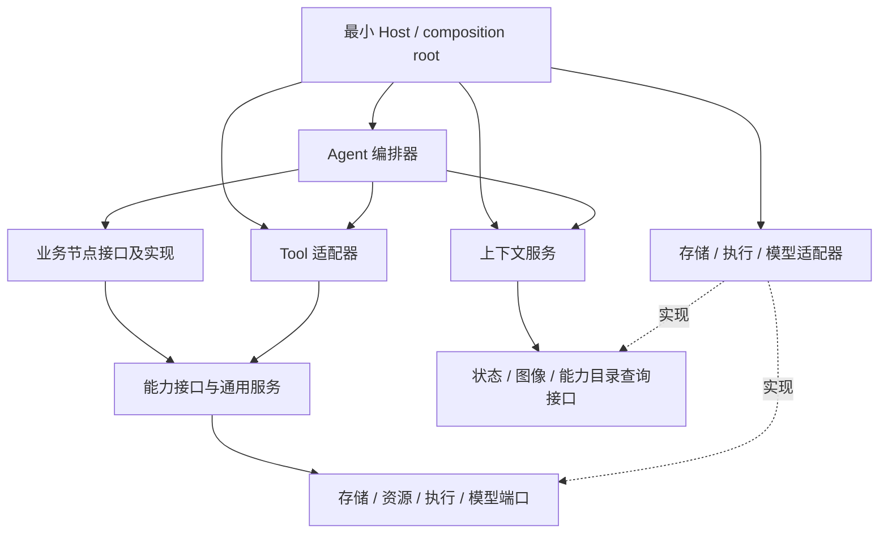
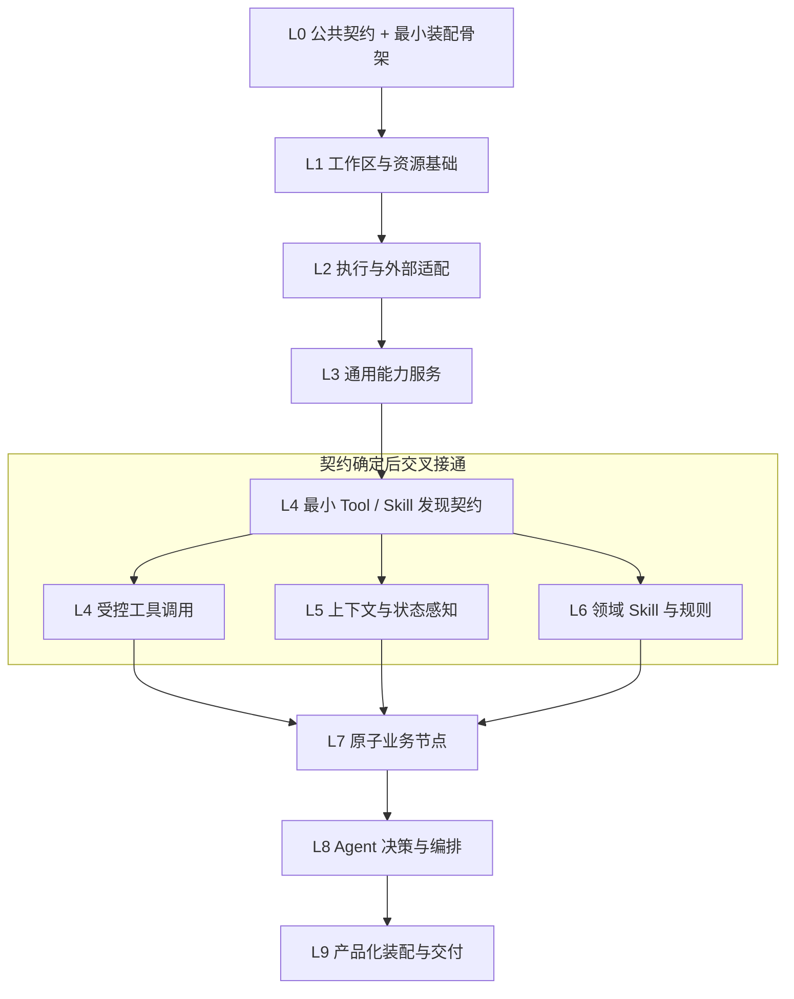

# Vet3D Agent 分层架构与实施路线

本大纲规定 Vet3D 从公共契约、底层基础设施到业务节点和 Agent 编排的开发顺序。每层先交付首条业务链所需的最小能力，通过验收后接通上层，再按业务扩展覆盖范围。层级是逻辑职责边界，不预设独立进程、微服务或仓库数量。

本文属于 **Vet3D 开发规划**。Hi3D Agent 1.2.11 的解析、原件和合成试验作为参考证据；本文规定的接口、工作条目、恢复规则及完成条件属于 Vet3D 设计，不能据此宣称产品已实现或动物样本已验收。 [Hi3D 参考导航](../../hi3d/README.md)

[分层实施清单](layers.md) · [工作条目模板](work-item-template.md) · [架构与依赖](#架构与依赖) · [实施顺序](#实施顺序) · [阶段验收](#阶段验收) · [资源接入](#静态资源与脚本接入规则) · [待定决策](#待定决策与证据状态)

## 当前基线与文档职责

当前 `src/vet3d/infrastructure/hi3d_inventory/`、`scripts/hi3d/` 和 `tests/hi3d/` 提供发行盘点、ASAR 读取、抽离、优先级派生及归档核查。它们不证明 Vet3D 产品工作区、执行器、LLM 网关、上下文或业务编排已实现。产品实施条目的初始状态统一为 **未实施**。

| 文档 | 维护内容 |
| --- | --- |
| 本页 | 架构边界、实施顺序、依赖注入、阶段放行、资源采纳规则和待定决策。 |
| [分层实施清单](layers.md) | L0～L9 的具名工作条目、依赖、接口交接、验收及恢复；条目 ID 在后续拆卡时保留。 |
| [工作条目模板](work-item-template.md) | 单项实施的接口、状态源、依赖注入、失败落盘、验证及完成记录。进入当前阶段的条目再据此建立实施卡。 |
| `docs/hi3d/` | 固定版本参考行为、工具原文、资源和证据边界；产品改进在 Vet3D 文档中维护。 |

实施卡可以引用 Hi3D 业务、工具和资源说明。通用 Tool 文档维护模型可见描述、参数及实现；具体业务调用时机仍由业务节点维护。保持节点到工具页的单向引用，不为本大纲向原有通用工具页添加节点反链。

## 架构与依赖

### 三种关系分别维护

| 关系 | 规定 |
| --- | --- |
| 架构职责 | 哪一层拥有数据、接口、规则或执行机制。文件查询与主体判断、进程终态与业务验收分别有明确归属。 |
| 开发先后 | 哪些最小能力通过验收后，上层条目才可以开始接通。依赖指向具体条目和已验证契约，不要求先完成整层的全部扩展能力。 |
| 源码依赖与 IoC | 业务节点、上下文和服务依赖稳定接口；外部存储、执行程序及模型适配器实现接口，由装配入口注入。开发较早的模块不因此成为上层必须直接导入的具体实现。 |

公共语义与端口先按消费者需要定义。端口可以由稳定内核或消费方模块拥有，不由供应商 SDK、数据库表或桌面组件反向决定。共享层只容纳确有复用需要的语义，避免把全部业务规则堆入全局模块。

### 调用与装配

**Vet3D 设计示意。** 实线表示使用接口或构造装配，虚线表示适配器实现接口；不是文件夹导入顺序。实际包路径在 L0 决定。

最小 Host、替身适配器和装配入口在 L0 建立测试骨架，随每层增量接通。L9 完成产品宿主、启动、安装升级和整体装配，不是到该阶段才开始依赖注入。采用某个 Agent SDK 时，用适配边界约束它的消息、工具和持久化差异。

| 对象 | 依赖与暴露规则 |
| --- | --- |
| 基础设施 | 管理事实、存储和资源，不判断本次主体、视图是否定稿或动物形变是否合格。 |
| 通用能力服务 | 提供查询、导入、执行和发布等用例，可被 Tool、Host 和测试复用；不要求调用方具有 LLM 会话。 |
| LLM Tool | 将模型请求映射到受控能力。参数、作用域、权限及输出校验显式维护；不是每个脚本函数都注册为 Tool。 |
| Skill | 描述方法、选用条件与资源引用；资源发现不等于选用，选用不等于已调用，也不自动注册工具。强制规则落在业务校验器或编排守卫中。 |
| 上下文服务 | 从查询接口取得确切工作区、文件、视窗和能力状态，保留版本及陈旧信息；不通过目录存在推断模型已看过图。 |
| 业务节点与编排 | 节点拥有业务输入输出和验收；编排拥有节点迁移、决策边界、返工及恢复。两者通过端口使用具体能力。 |
| 装配入口 | 读取有效配置，选择并注入适配器与策略，发布当前可用能力；其他模块不自行创建全局数据库、供应商客户端或 Blender 进程管理器。 |

## 实施顺序

| 顺序 | 架构层 | 本层主要交付 |
| --- | --- | --- |
| 00 | [L0 公共语义与接口契约层](layers.md#l0-公共语义与接口契约层) | 身份、数据与错误语义、单位和方向、端口、模块依赖规则、最小装配骨架。 |
| 01 | [L1 基础设施层](layers.md#l1-基础设施层) | 工作区、路径与持久化、原件、受管资源包、配置、环境及日志基础。 |
| 02 | [L2 执行与外部适配层](layers.md#l2-执行与外部适配层) | 本地执行、远端适配、作业与尝试、续查、取消、下载和恢复。 |
| 03 | [L3 通用能力服务层](layers.md#l3-通用能力服务层) | 对上层稳定的导入、查询、脚本执行、回读、发布及交付服务。 |
| 04 | [L4 Tool 契约与能力暴露层](layers.md#l4-tool-契约与能力暴露层) | 工具定义与目录、注册和校验、作用域治理、Skill／资源发现契约。 |
| 05 | [L5 LLM 上下文与状态感知层](layers.md#l5-llm-上下文与状态感知层) | 当前轮快照、实际图像投递、状态刷新、能力信息及恢复上下文。 |
| 06 | [L6 领域 Skill 与业务策略层](layers.md#l6-领域-skill-与业务策略层) | 动物领域方法、规则、能力要求和确定性校验，按首条业务链选用。 |
| 07 | [L7 原子业务节点层](layers.md#l7-原子业务节点层) | 输入输出明确的业务节点、候选验收、修订出口和下游交接。 |
| 08 | [L8 Agent 决策与流程编排层](layers.md#l8-agent-决策与流程编排层) | LLM 决策循环、节点调度、条件分支、交互、暂停和恢复。 |
| 09 | [L9 产品宿主与整体交付层](layers.md#l9-产品宿主与整体交付层) | 用户界面、视窗集成、启动安装、产品配置、诊断和整体交付。 |

**Vet3D 设计示意。** 箭头表示默认接通顺序；L4～L6 是围绕共同契约协作的一组能力，不要求全层串行完工。

### 分层实施约束

1. **先确定边界，再实现机制。** L0 定义首条链路需要的最小接口，L1、L2 实现这些端口，L3 以稳定服务接通；扩展接口前记录消费者与验证场景。
2. **状态感知从首期验收。** L1 开始提供查询事实，L3 提供查询服务，L5 完成模型输入策略。首期通过最小 Host 检查状态，不等所有生命周期功能完成才验证。
3. **按最小条目跨层放行。** 例如首期资源定位及短脚本执行通过后，可接工具和上下文；不以完整资源库、全部云端后端或完整编辑器为开工条件。
4. **真实依赖逐个替换。** 未选模型时使用显式替身验证接口和恢复。替身结果单独标记；接入真实模型后完成真实请求、图像投递及产物验收，不能沿用替身结论。
5. **接口与实现有版本依据。** 上层交接记录实现版本、输入文件和参数身份；能力缺失、视角不支持或契约版本冲突有明确错误，不静默降级。

## 阶段验收

下表为实施里程碑，不是对当前进度的声明。全部阶段初始 **未实施**；进入下一阶段依赖本阶段所需条目已验收。上层骨架可以提前使用替身开发，接真实能力前必须补齐对应门槛。

| 里程碑 | 对应层与范围 | 放行证据 |
| --- | --- | --- |
| M0 契约与装配骨架 | L0 | 统一身份及语义、最小端口和模块边界已评审；替身可完成一次请求、状态记录和输出引用；装配入口可替换适配器。 |
| M1 本地基础设施闭环 | L1～L3 的首期能力 | 创建工作区，导入照片和已知 GLB，定位固定资源版本，执行短脚本／后台 Blender，得到报告、预览和导出件；重启后能核对同一输入、执行和产物。 |
| M2 Agent 能力接通 | L4～L6 的首期能力 | 一个可替换的真实 LLM 适配器可取得正确工具目录和上下文、接收实际图片并调用工具；缺能力、陈旧状态、取消及恢复有记录。替身可先验证协议，正式放行需要真实模型记录。 |
| M3 首条建模业务闭环 | L7～L8 的首条业务链 | 从用户照片、主体与视图准备到真实 3D 任务受理、原任务续查、下载、候选验收和交付；五视图要求与后端能力显式匹配，提交不明不会盲目新建作业。 |
| M4 动画目标与产品交付 | 扩展 L6～L8，完成 L9 | 按首发支持范围接入必要修订、骨架／蒙皮、动作与导出回读；用目标动物样本验证后完成安装、重启、视窗、取消和保存交接。未支持条件分支公开记录，不把静态建模闭环当完整动画目标完成。 |

每次放行关联实际执行记录、输入与输出摘要、环境及验收结论。新实现、更换资源版本或输入发生影响结论的变化时，按影响范围重新验证。

### 必须分开的状态

| 事实 | 证据与责任 |
| --- | --- |
| 执行完成 | 原进程或远端作业终态及诊断；执行器负责，不推导业务合格。 |
| 文件与报告存在 | 实际路径、字节身份、报告完整性及本轮来源；产物服务与报告适配器负责。 |
| 内容验收通过 | 明确对象、用途、检查范围、阈值及未覆盖项；业务节点负责。 |
| 模型版本发布 | 实际返回版本及其文件摘要；发布服务负责，复用也要对账。 |
| 视窗就绪 | 当前组件、加载代次及确切文件；视窗适配器负责，界面列表选中不是等价状态。 |
| 外部保存完成 | 宿主复制／下载终态及目标；提供工作区链接与用户实际保存分别记录。 |

执行作业账本、业务节点状态和视窗状态分别拥有权威来源。聚合视图可以展示它们，但不得用任一状态覆盖其他事实。

## 静态资源与脚本接入规则

P0、P1 是 Hi3D 证据归档和抽离标签。开发优先级另分为 **首期闭环、首批业务、条件扩展**，每项再标明所属层与前置条目，不把归档标签转换为必须逐文件照搬的顺序。

| 接入批次 | 能力与归属 | 交接要求 |
| --- | --- | --- |
| 首期闭环 | L1 资源清单、摘要、依赖与安装定位；L2 执行包装、预算、日志和输入输出身份；L3 图片拼版、GLB 回读、明确对象导出及五向预览。 | 可以同时参考 P0、P1，采纳实际需要的最小依赖闭包。 |
| 首批业务 | L3、L6、L7 使用的质量测量、几何／UV／材质检查和所选后端适配。 | 依实际输入格式、坐标、单位和产物契约验证；受支持范围进入能力目录。 |
| 条件扩展 | 烘焙、设备适配、权重与动作采样、专项脚本及领域素材。 | 随相应业务接入，完整记录依赖、版本、适用对象和失败文件边界。 |

每个采纳资源至少记录：身份类型、用途、来源、版本与 SHA-256、依赖、解释器、入口、输入输出、覆盖与同址规则、失败产物、开发优先级、采纳方式和验证状态。采纳方式使用 **借鉴机制、独立实现、评估接入、暂缓**；直接引入上游原件前确认其可用范围及来源条件。

受管资源与任务工作区分开；运行中的会话或作业固定资源版本。资源文件存在、成功安装和实际可执行分别检查。原脚本缺少的新路径、输入／报告隔离、最终非空或有限性门槛，在 Vet3D 包装或业务校验中明确补足；不把原脚本假设为原子事务。

[资源基础设施](../../hi3d/infrastructure/bundled-assets-and-script-tools.md) · [P0 索引](../../hi3d/resources/README.md) · [P1 索引](../../hi3d/resources/p1/README.md) · [专项脚本边界](../../hi3d/resources/specialized-mesh-scripts.md)

## 待定决策与证据状态

| 决策 | 最迟确定点 | 当前处理 |
| --- | --- | --- |
| 首期宿主语言、包布局、目标平台及模块边界 | L0 装配骨架开始运行前 | 待选型。现有 Python 盘点工具和本机 Windows 环境不自动决定产品技术栈或跨平台能力。 |
| 持久化机制、文件发布与并发策略 | L1 相应条目实施前 | 待选型。先按恢复、幂等和一致性要求定义端口及验收。 |
| Agent SDK／运行内核与工具路由 | L4、L5 接真实 Runtime 前 | 待选型。稳定契约隔离消息、工具、会话及恢复差异，不重新研究无关内核细节。 |
| LLM、多模态输入及上下文预算 | M2 真实模型验收前 | 待选型。先定义中性输入角色、图像身份和工具协议，以替身检验组装。 |
| 生图、3D 与后处理供应商 | 对应真实能力接入前 | 待选型。业务保存主体基准、补充参考、目标方向和必保特征；供应商字段仅出现在适配器。 |
| 首发编辑器、视窗和导出格式支持 | 相应 L3 服务及 L9 集成前 | 待定。最小版本加载与视觉证据可先接通，完整编辑功能逐项加入。 |
| 首发动物类型、质量标准与条件分支范围 | L6 规则及对应 M3／M4 放行前 | 待确定。固定五向语义，后端不支持所需参与方式时明确报告能力不匹配。 |

证据状态分别记录为 **Hi3D 静态已核、隔离夹具已测、Vet3D 已实现、Vet3D 已验收、目标动物实测通过**。同一条目可以有多种证据，但状态不自动递推。实际工具开放、资源选用、执行结果与业务质量分别记录。

## 后续逐项实施入口

从 [L0](layers.md#l0-公共语义与接口契约层) 建立首期接口与最小装配骨架，再展开 L1 工作区和资源条目。选中一个条目后，按[工作条目模板](work-item-template.md)补齐输入输出、状态源、注入依赖、异常恢复及验收；已有工作区事实可以尽早在 Host 中查询，为 L5 提供验证基线。

更新进度时，实施卡是详细证据记录，分层清单维护汇总状态，本页维护阶段放行。设计已写成文档只代表规划完成；产品状态须由实现和验证证据更新。
