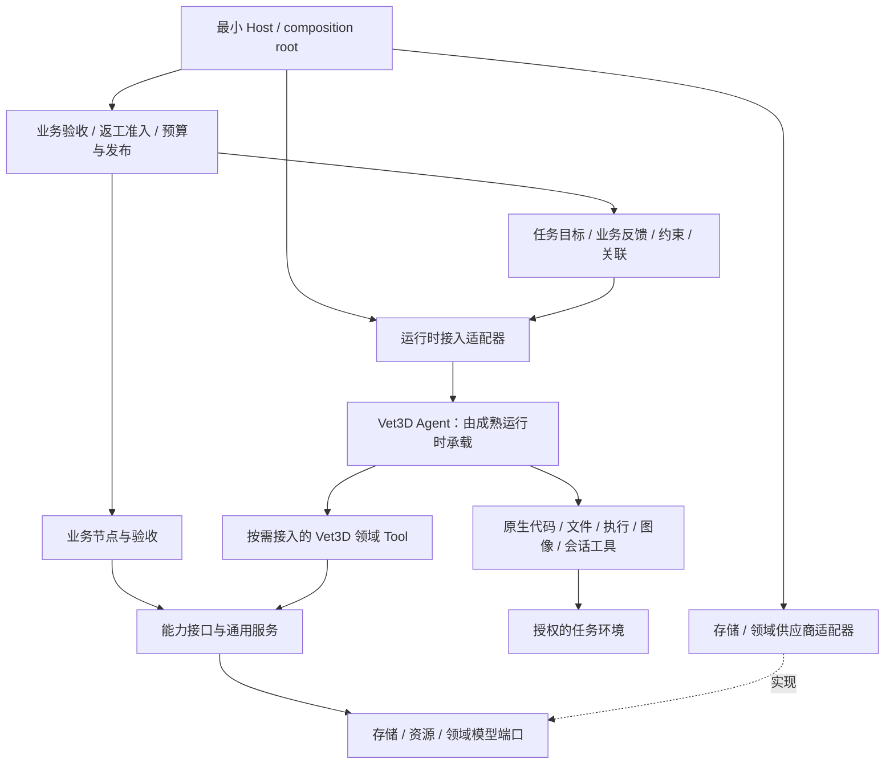
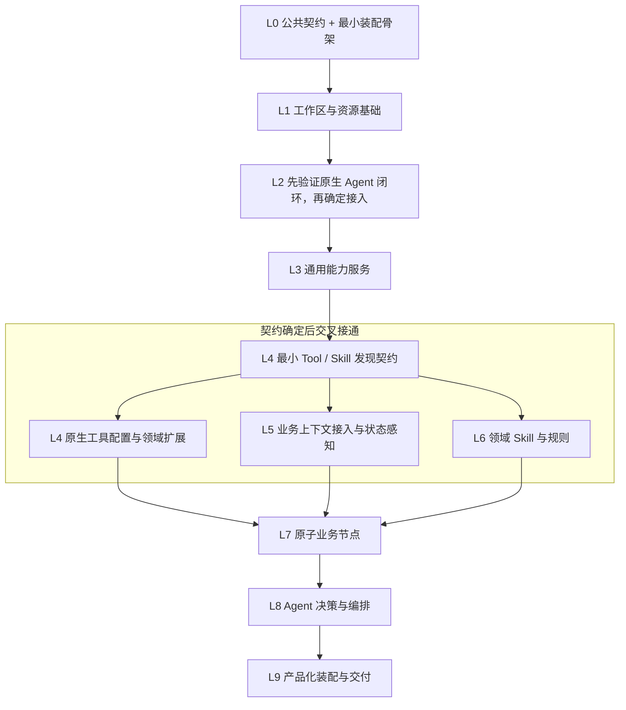

# Vet3D Agent 分层架构与实施路线

本大纲规定 Vet3D 从公共契约、底层基础设施到业务节点和 Agent 编排的开发顺序。每层先交付首条业务链所需的最小能力，通过验收后接通上层，再按业务扩展覆盖范围。层级是逻辑职责边界，不预设独立进程、微服务或仓库数量。

本文属于 **Vet3D 开发规划**。Hi3D Agent 1.2.11 的解析、原件和合成试验作为参考证据；本文规定的接口、工作条目、恢复规则及完成条件属于 Vet3D 设计，不能据此宣称产品已实现或动物样本已验收。 [Hi3D 参考导航](../../hi3d/README.md)

[分层实施清单](layers.md) · [工作条目模板](work-item-template.md) · [架构与依赖](#架构与依赖) · [实施顺序](#实施顺序) · [阶段验收](#阶段验收) · [资源接入](#静态资源与脚本接入规则) · [待定决策](#待定决策与证据状态)

## 当前基线与文档职责

当前 `src/vet3d/infrastructure/hi3d_inventory/`、`src/vet3d/infrastructure/hi3d_reference/`、`scripts/hi3d/` 和 `tests/hi3d/` 提供发行盘点、ASAR 读取、抽离、优先级派生、参考包及证据核查。它们不证明 Vet3D 产品工作区、执行器、LLM 网关、上下文或业务编排已实现。

[L0-01 最小应用入口与装配骨架](work-items/L0-01.md)、[L0-02 身份与关联](work-items/L0-02.md)、[L0-03 文件、来源、单位与视图契约](work-items/L0-03.md)和 [L0-04 独立事实、结果与交接守卫](work-items/L0-04.md)及 [L0-05 最小生成端口与装配探针](work-items/L0-05.md)为 **已完成**，包括准备语义修订。[L1-01](work-items/L1-01.md)、[L1-02](work-items/L1-02.md)、[L1-03](work-items/L1-03.md)、[L1-04](work-items/L1-04.md)和 [L1-05](work-items/L1-05.md)已完成各卡限定的本期范围，[L2-01](work-items/L2-01.md)已完成有限 CPU 环境探测范围；[L2-02](work-items/L2-02.md)为 **阶段 A 已开展，产品接入未完成**，具体证据与限制见该卡；其他产品条目保持 **未实施**。接口、运行方式和验证记录由各实施卡维护。设计理由分别见 [ADR 0001](../adr/0001-service-host-and-composition.md)、[ADR 0002](../adr/0002-identity-and-relations.md)、[ADR 0003](../adr/0003-content-and-view-contracts.md)、[ADR 0004](../adr/0004-independent-facts-and-outcomes.md)及 [ADR 0005](../adr/0005-preparation-and-generation-ports.md)；ADR 0003 的视图参与语义由 ADR 0005 修订。

| 文档 | 维护内容 |
| --- | --- |
| 本页 | 架构边界、实施顺序、依赖注入、阶段放行、资源采纳规则和待定决策。 |
| [分层实施清单](layers.md) | L0～L9 的具名工作条目、依赖、接口交接、验收及恢复；条目 ID 在后续拆卡时保留。 |
| [工作条目模板](work-item-template.md) | 单项实施的接口、状态源、依赖注入、失败落盘、验证及完成记录。进入当前阶段的条目再据此建立实施卡。 |
| [L0-01 实施卡](work-items/L0-01.md) | 本项当前接口语义、运行入口、实现出处、验证记录及放行边界的唯一说明；其他导航引用本卡。 |
| [L0-02 实施卡](work-items/L0-02.md) | 本项身份、关联、局部校验和验证范围的唯一说明；其他导航引用本卡。 |
| [L0-03 实施卡](work-items/L0-03.md) | 本项内容、定位、来源、单位、视图及验证范围的唯一说明；其他导航引用本卡。 |
| [L0-04 实施卡](work-items/L0-04.md) | 本项独立事实、诊断、检查结果、交接守卫及恢复边界的唯一说明；其他导航引用本卡。 |
| [L0-05 实施卡](work-items/L0-05.md) | 本期已消费端口、单次生成计划、替身装配探针、验证及恢复边界的唯一说明；其他导航引用本卡。 |
| [L1-01 实施卡](work-items/L1-01.md) | 当前工作区注册接口、身份关联、存储与宿主装配、恢复、实际验证及执行消费者交接；理由见 [ADR 0006](../adr/0006-workspace-storage-and-execution-boundaries.md)。 |
| [L1-02 实施卡](work-items/L1-02.md) | 当前文件保存与观察接口、输入范围、字节副作用、恢复及验证；理由见 [ADR 0007](../adr/0007-managed-file-storage-boundaries.md)。 |
| [L1-03 实施卡](work-items/L1-03.md) | 当前资源清单、构建与安装、固定快照读取、恢复及验证记录；理由见 [ADR 0008](../adr/0008-managed-resource-snapshots.md)。 |
| [L1-04 实施卡](work-items/L1-04.md) | 当前单资产持久目录、真实 ArtifactAccess、独立有界文件 I/O 与短元数据调用、恢复及验证记录；理由见 [ADR 0009](../adr/0009-single-artifact-catalog.md)。 |
| [L1-05 实施卡](work-items/L1-05.md) | 当前统一配置、关联诊断、Docker 宿主、恢复和真实验证；理由见 [ADR 0010](../adr/0010-settings-diagnostics-and-docker.md)。 |
| [L2-01 实施卡](work-items/L2-01.md) | 当前固定资源环境核对、真实进程观察、恢复和实测交接；理由见 [ADR 0011](../adr/0011-bounded-environment-probes.md)。 |
| [L2-02 实施卡](work-items/L2-02.md) | 阶段 A 已开展，产品接入未完成；维护实验入口、真实闭环证据、职责、恢复及未决项；方向与取舍见 [ADR 0012](../adr/0012-native-agent-runtime-integration.md)。 |
| [架构决策记录](../adr/0001-service-host-and-composition.md) | 已接受的设计选择、原因、替代方案与历史决策；不重复维护当前接口。 |
| `docs/hi3d/` | 固定版本参考行为、工具原文、资源和证据边界；产品改进在 Vet3D 文档中维护。 |

实施卡可以引用 Hi3D 业务、工具和资源说明。Vet3D 领域 Tool 文档维护自有工具的模型可见描述、参数及实现；原生工具以选定运行时的协议及文档为准，只记录实际接入差异，不复制工具目录或分派实现。业务适用条件与交接时机由业务节点维护，具体建模工具选择与操作顺序由原生 Agent 决定；保持节点到工具页的单向引用。

## 架构与依赖

### 产品调用边界

Vet3D 的目标是供 BFF 调用的后端服务。正常链路由后端自主执行与验收，在明确预算内修订；信息不足、预算耗尽或处理失败时返回可判断的结果，不依赖用户持续审查。BFF 负责接入与呈现，后端拥有业务执行及修订预算。显式用户交互、桌面宿主和编辑器属于按需扩展。当前装配条目的实际覆盖范围见 [L0-01](work-items/L0-01.md)，不据此宣称 HTTP、真实 BFF 或自动质量验收已经接通。

首期五向是业务准备方案，用户可提交少量照片，由后续节点按策略判断主体并补全视图。准备要求与一次供应商调用的输入不同：业务可以选择准备集中的部分图片，适配器按具体计划核对而不自行删图。当前契约分别见 [L0-03](work-items/L0-03.md)与 [L0-05](work-items/L0-05.md)；自动补图、路线选择及视觉验收尚未实现。

持久工作区与执行环境分别管理。L1-01 的当前实现及后续首次开放不可信代码所需的权限、并行和接收边界，统一见[工作区实施卡](work-items/L1-01.md#8-完成与上层放行)；本总纲不把目录创建或工具可见性当作执行隔离证明。

Agent 集成方向已按 [ADR 0012](../adr/0012-native-agent-runtime-integration.md)确定：Vet3D Agent 由成熟运行时直接承载，原生 Agent 唯一负责建模规划、工具选择、错误理解、视觉观察与修订，运行时管理会话上下文；阶段 A 已开展，产品接入未完成，实验观察不代表整体验收。Vet3D 接入层负责业务接入与协议连接，L8 保留验收、返工准入、预算及发布规则；继续输入和建模决策权边界统一见 [L2-02](work-items/L2-02.md#继续输入与建模决策权)。当前 Agent 路径不要求代码冻结、输入快照或字节追溯。

### 三种关系分别维护

| 关系 | 规定 |
| --- | --- |
| 架构职责 | 哪一层拥有数据、接口、规则或执行机制。文件查询与主体判断、进程终态与业务验收分别有明确归属。 |
| 开发先后 | 哪些最小能力通过验收后，上层条目才可以开始接通。依赖指向具体条目和已验证契约，不要求先完成整层的全部扩展能力。 |
| 源码依赖与 IoC | 业务节点、上下文和服务依赖稳定接口；外部存储、执行程序及模型适配器实现接口，由装配入口注入。开发较早的模块不因此成为上层必须直接导入的具体实现。 |

公共语义与端口先按消费者需要定义。端口可以由稳定内核或消费方模块拥有，不由供应商 SDK、数据库表或桌面组件反向决定。共享层只容纳确有复用需要的语义，避免把全部业务规则堆入全局模块。

### 调用与装配

**Vet3D 设计示意。** 实线表示使用接口或构造装配，虚线表示适配器实现接口；不是文件夹导入顺序。实际包路径在 L0 决定。

最小 Host、替身适配器和装配入口在 L0 建立测试骨架，随每层增量接通。L9 完成产品宿主、启动、安装升级和整体装配，不是到该阶段才开始依赖注入。运行时适配边界只承担实际接入差异；图中的调用关系不表示父子建模 Agent，也不要求独立服务或新增协议。原生工具反馈在运行时内部进入模型，由原生 Agent 决定下一步建模动作，BFF 进度摘要不替代该反馈。

| 对象 | 依赖与暴露规则 |
| --- | --- |
| 基础设施 | 管理事实、存储和资源，不判断本次主体、视图是否定稿或动物形变是否合格。 |
| 通用能力服务 | 提供查询、导入、领域处理和发布等实际消费者需要的用例，可脱离 LLM 测试；不包装全部原生文件或执行操作。 |
| LLM Tool | 原生工具由运行时提供和分派；Vet3D 仅为确有业务用途的领域能力维护参数、作用域与输出校验，不把普通库函数全部注册为 Tool。 |
| Skill | 描述方法、选用条件与资源引用；资源发现不等于选用，选用不等于已调用，也不自动注册工具。强制规则落在业务校验器或编排守卫中。 |
| 上下文接入 | 向原生会话提供业务事实及必要引用，核对新旧版本和实际图像投递；会话上下文、工具反馈与压缩由运行时管理，不通过整理反馈逐步指挥建模修复。 |
| 业务节点与编排 | 固定职责的领域服务提供评估结果与证据，编排管理业务验收、返工准入、任务预算、节点交接与发布规则；自动业务反馈不等于第二个 Agent，具体检查、编程、工具选择和修订由原生 Agent 决定。 |
| 装配入口 | 读取有效配置并注入运行时、存储和领域适配器与冻结业务策略；环境权限不反向定义业务动作或发布资格，不新增无消费者的通用执行入口。 |

## 实施顺序

| 顺序 | 架构层 | 本层主要交付 |
| --- | --- | --- |
| 00 | [L0 公共语义与接口契约层](layers.md#l0-公共语义与接口契约层) | 身份、数据与错误语义、单位和方向、端口、模块依赖规则、最小装配骨架。 |
| 01 | [L1 基础设施层](layers.md#l1-基础设施层) | 工作区、路径与持久化、原件、受管资源包、配置、环境及日志基础。 |
| 02 | [L2 执行与外部适配层](layers.md#l2-执行与外部适配层) | 原生 Agent 运行时接入与选型验证、授权执行环境、业务执行关联及领域远端适配。 |
| 03 | [L3 通用能力服务层](layers.md#l3-通用能力服务层) | 对上层稳定的导入、查询、领域处理、回读、发布及交付服务。 |
| 04 | [L4 Tool 契约与能力暴露层](layers.md#l4-tool-契约与能力暴露层) | 原生工具配置与可用性验证、必要领域工具、Skill／资源接入。 |
| 05 | [L5 LLM 上下文与状态感知层](layers.md#l5-llm-上下文与状态感知层) | 向原生会话接入业务事实，验证图像投递、状态刷新与会话恢复。 |
| 06 | [L6 领域 Skill 与业务策略层](layers.md#l6-领域-skill-与业务策略层) | 动物领域方法、规则、能力要求和确定性校验，按首条业务链选用。 |
| 07 | [L7 原子业务节点层](layers.md#l7-原子业务节点层) | 输入输出明确的业务节点、候选验收、修订出口和下游交接。 |
| 08 | [L8 Agent 决策与流程编排层](layers.md#l8-agent-决策与流程编排层) | 原生 Agent 与业务节点衔接、验收、返工准入、任务预算、发布规则及业务暂停／恢复。 |
| 09 | [L9 产品宿主与整体交付层](layers.md#l9-产品宿主与整体交付层) | 用户界面、视窗集成、启动安装、产品配置、诊断和整体交付。 |

**Vet3D 设计示意。** 箭头表示默认接通顺序；L4～L6 是围绕共同契约协作的一组能力，不要求全层串行完工。

### 分层实施约束

1. **先确定边界，再实现机制。** L0 定义首条链路需要的最小接口，L1、L2 实现这些端口，L3 以稳定服务接通；扩展接口前记录消费者与验证场景。
2. **状态感知从首期验收。** L1 开始提供查询事实，L3 提供查询服务，L5 完成模型输入策略。首期通过最小 Host 检查状态，不等所有生命周期功能完成才验证。
3. **按最小条目跨层放行。** 例如首期资源定位及短脚本执行通过后，可接工具和上下文；不以完整资源库、全部云端后端或完整编辑器为开工条件。
4. **真实依赖按决策需要验证。** 替身验证关联、解析和异常协议；L2-02 阶段 A 按该卡的自主修正条件验证真实原生闭环，再确定接入方式和公开接口，不能推迟到 M2。完整领域质量仍由后续里程碑验证。
5. **接口与实现有版本依据。** 运行时协议与实际依赖版本有明确依据，业务输入按其已有契约交接；不把版本管理扩展成逐次原生工具的代码和输入冻结。能力缺失、视角不支持或契约版本冲突有明确结果，不静默降级。

## 阶段验收

下表规定实施里程碑的放行要求。当前 L0-01～L0-05 已完成，**M0 按 [L0-05](work-items/L0-05.md)的最小消费链范围放行**，不代表所有未来端口或生产能力齐备；L1-01～L1-05 及 L2-01 已完成各自本期范围，M1 尚未放行，M2～M4 保持未实施。进入下一阶段依赖本阶段所需条目已验收。上层骨架可以提前使用替身开发，接真实能力前必须补齐对应门槛。

| 里程碑 | 对应层与范围 | 放行证据 |
| --- | --- | --- |
| M0 契约与装配骨架 | L0 | 统一身份及语义、最小端口和模块边界已评审；替身可完成一次请求、状态记录和输出引用；装配入口可替换适配器。 |
| M1 本地基础设施闭环 | L1～L3 的首期能力 | 创建工作区、导入照片和已知 GLB、定位受管资源；完成 L2-02 原生 Agent 最小闭环及授权隔离检查，交接预览和导出件；分别实测会话、工作文件、运行进程与正式产物的重启边界，不承诺逐次执行内容复现。 |
| M2 Agent 能力接通 | L4～L6 的首期能力 | 在 L2-02 已验证的原生循环上接入所需领域工具、Skill 与业务上下文；真实模型验证新增能力、图片投递、陈旧状态及业务恢复。最小原生工具闭环不等到本阶段才验证，替身不证明模型语义。 |
| M3 首条建模业务闭环 | L7～L8 的首条业务链 | 从用户照片、主体与视图补全准备到真实 3D 任务受理、原任务续查、下载、候选验收和交付；业务准备要求与单次生成计划分别满足，具体计划与后端能力匹配，提交不明不会盲目新建作业。 |
| M4 动画目标与产品交付 | 扩展 L6～L8，完成 L9 | 按首发支持范围接入必要修订、骨架／蒙皮、动作与导出回读；用目标动物样本验证后完成安装、重启、视窗、取消和保存交接。未支持条件分支公开记录，不把静态建模闭环当完整动画目标完成。 |

每次放行关联实际执行记录、输入与输出摘要、环境及验收结论。新实现、更换资源版本或输入发生影响结论的变化时，按影响范围重新验证。

### 必须分开的状态

| 事实 | 证据与责任 |
| --- | --- |
| 执行完成 | 原进程或远端作业终态及诊断；执行器负责，不推导业务合格。 |
| 文件与报告存在 | 实际路径、字节身份、报告完整性及本轮来源；产物服务与报告适配器负责。 |
| 内容验收通过 | 明确对象、用途、检查范围、阈值及未覆盖项；业务节点负责。 |
| 模型版本发布 | 实际返回版本及其文件摘要；发布服务负责，复用也要对账。 |
| 视窗就绪 | 当前组件、加载代次及确切文件；视窗适配器负责，界面列表选中不是等价状态。 |
| 外部保存完成 | 宿主复制／下载终态及目标；提供工作区链接与用户实际保存分别记录。 |

原生执行与会话记录、领域远端作业事实、业务节点状态和视窗状态分别拥有权威来源。L2-03 仅补业务关联和实际缺失的恢复信息，不复制原生状态机或工具历史。聚合视图不得用任一状态覆盖其他事实。当前已实现的声明契约及纯校验见 [L0-04](work-items/L0-04.md)，不据此宣称这些真实生产者或持久服务已经完成。

## 静态资源与脚本接入规则

P0、P1 是 Hi3D 证据归档和抽离标签。开发优先级另分为 **首期闭环、首批业务、条件扩展**，每项再标明所属层与前置条目，不把归档标签转换为必须逐文件照搬的顺序。

| 接入批次 | 能力与归属 | 交接要求 |
| --- | --- | --- |
| 首期闭环 | L1 资源清单、摘要、依赖与安装定位；L2 原生运行时、授权环境及任务关联；L3 按消费者提供图片拼版、GLB 回读、明确对象导出及五向预览。 | 可以同时参考 P0、P1，采纳实际需要的最小依赖闭包。 |
| 首批业务 | L3、L6、L7 使用的质量测量、几何／UV／材质检查和所选后端适配。 | 依实际输入格式、坐标、单位和产物契约验证；受支持范围进入能力目录。 |
| 条件扩展 | 烘焙、设备适配、权重与动作采样、专项脚本及领域素材。 | 随相应业务接入，完整记录依赖、版本、适用对象和失败文件边界。 |

每个采纳资源至少记录：身份类型、用途、来源、版本与 SHA-256、依赖、解释器、入口、输入输出、覆盖与同址规则、失败产物、开发优先级、采纳方式和验证状态。采纳方式使用 **借鉴机制、独立实现、评估接入、暂缓**；直接引入上游原件前确认其可用范围及来源条件。

受管资源与任务工作区分开；运行中的会话或作业固定资源版本。资源文件存在、成功安装和实际可执行分别检查。原脚本缺少的新路径、输入／报告隔离、最终非空或有限性门槛，在 Vet3D 包装或业务校验中明确补足；不把原脚本假设为原子事务。

上述采纳与版本规则仅适用于受管资源，动态任务脚本无需预登记、预发布或修改装配。普通工作文件沿原生工具修改和使用；资源摘要、正式资产完整性及业务版本校验不扩展为每次执行的冻结或内容追溯要求。

当前资源维护源、构建清单、安装与固定引用的契约和验证记录由 [L1-03](work-items/L1-03.md)维护；安装不代替后续环境、执行或模型侧投递的验收。

[资源基础设施](../../hi3d/infrastructure/bundled-assets-and-script-tools.md) · [P0 索引](../../hi3d/resources/README.md) · [P1 索引](../../hi3d/resources/p1/README.md) · [专项脚本边界](../../hi3d/resources/specialized-mesh-scripts.md)

## 待定决策与证据状态

| 决策 | 最迟确定点 | 当前处理 |
| --- | --- | --- |
| 首期宿主语言、包布局、目标平台及模块边界 | L0 装配骨架开始运行前 | 已选择独立 CPython 3.14、uv、Hatchling 和 src-layout，以当前 Debian 环境验收。模块决策见 [ADR 0001](../adr/0001-service-host-and-composition.md)，实际实现与验证见 [L0-01](work-items/L0-01.md)。 |
| 持久化机制、文件提交与并发策略 | 相应真实消费者接入前 | 工作区、文件、资源及单资产目录分别见 [L1-01](work-items/L1-01.md)、[L1-02](work-items/L1-02.md)、[L1-03](work-items/L1-03.md)和 [L1-04](work-items/L1-04.md)；执行记录、报告声明和版本发布的持久化由后续 L2／L3 消费者提出，不以当前资产目录代替。 |
| 不可信代码执行平台、Blender 与设备 | L2-02 阶段 A 实际开放动态代码前，随原生运行时接入验证 | 平台未选定；[ADR 0006](../adr/0006-workspace-storage-and-execution-boundaries.md)保留历史候选，当前决策顺序见 [ADR 0012](../adr/0012-native-agent-runtime-integration.md)。先核对运行时已有能力，再补具体隔离缺口；交接门槛见 [L1-01](work-items/L1-01.md#8-完成与上层放行)。 |
| Agent 运行时、协议版本与原生工具接入 | L2-02 阶段 A 真实闭环后、公开接口确定前 | 优先验证完整 Codex app-server 线程／轮次路线；这是设计方向，不是完成选型。候选比较理由见 ADR 0012，具体决策及放行见 [L2-02](work-items/L2-02.md)。 |
| LLM、多模态输入及上下文预算 | L2-02 阶段 A 前明确实验连接；后续领域接入继续验证适用性 | 后续基模家族已确定为 Qwen，具体型号／直连接入仍待实测；候选与历史登录连接的证据分别见 [L2-02](work-items/L2-02.md)。实验须使用真实支持工具和图片输入的模型，显式配置连接和有限预算，不以替身或路径事件代替实际图像反馈。 |
| 生图、3D 与后处理供应商 | 对应真实能力接入前 | 待选型。业务保存主体基准、补充参考、目标方向和必保特征；供应商字段仅出现在适配器。 |
| 首发编辑器、视窗和导出格式支持 | 相应 L3 服务及 L9 集成前 | 待定。最小版本加载与视觉证据可先接通，完整编辑功能逐项加入。 |
| 首发动物类型、质量标准与条件分支范围 | L6 规则及对应 M3／M4 放行前 | 待确定。固定业务准备与验收要求，按具体生成计划核对能力；单图或四图接口本身不构成五向准备方案不受支持的结论。 |

证据状态分别记录为 **Hi3D 静态已核、隔离夹具已测、Vet3D 已实现、Vet3D 已验收、目标动物实测通过**。同一条目可以有多种证据，但状态不自动递推。实际工具开放、资源选用、执行结果与业务质量分别记录。

## 后续逐项实施入口

当前 [L1-01](work-items/L1-01.md)、[L1-02](work-items/L1-02.md)、[L1-03](work-items/L1-03.md)、[L1-04](work-items/L1-04.md)和 [L1-05](work-items/L1-05.md)已完成各自本期范围；[L2-01](work-items/L2-01.md)也已完成本期范围。[L2-02](work-items/L2-02.md)阶段 A 已开展，产品接入未完成；实例与认证依赖、已测路径和结论范围由该卡维护，不能以有限实验替代完整放行，也不能先建立通用执行主入口再补原生反馈。其他条目进入当前范围后，再按[工作条目模板](work-item-template.md)补齐实际消费者需要的接口、状态源、注入、恢复及验收。工作区登记、资产登记、文件观察和资源声明不能互相推导，也不代表图像已解码或 LLM 已感知。

更新进度时，实施卡是详细证据记录，分层清单维护汇总状态，本页维护阶段放行。设计已写成文档只代表规划完成；产品状态须由实现和验证证据更新。
